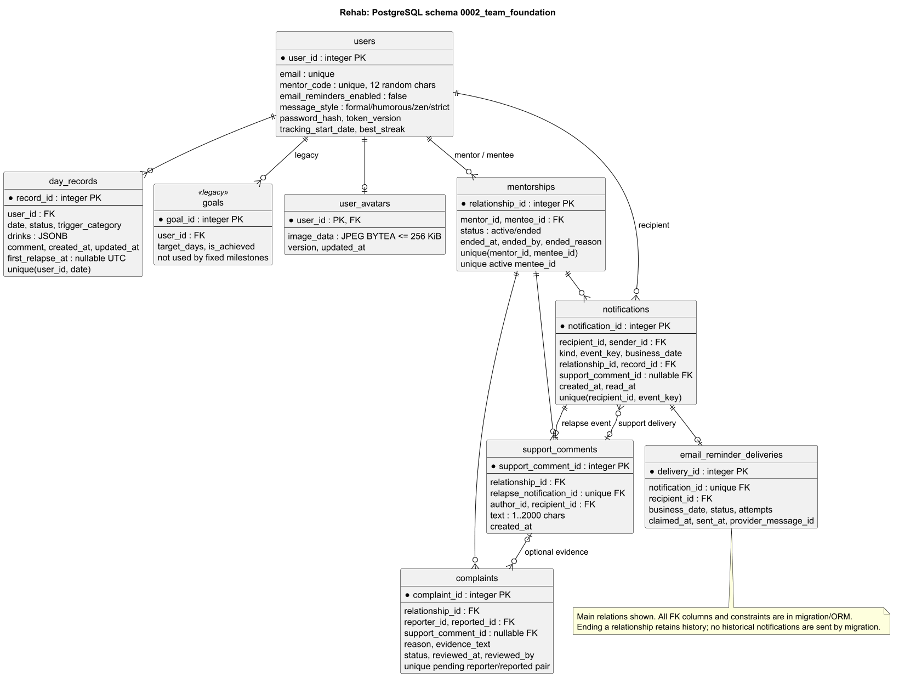

# Модель даних Rehab

## Схема та межі готовності

0001_initial створює users, day_records та legacy goals.
0002_team_foundation додає спільну основу профілю, менторства,
повідомлень, скарг і поштових нагадувань. Усі відповідні API та клієнтські екрани підключено до основного застосунку. Застосування міграції в онлайн-БД перевіряється перед відповідним релізом.

[PlantUML](uml/implemented-data-model.puml) показує основні зв'язки.
Усі колонки, FK і CHECK — у міграції та ORM.
[Контракт API](../api/api-design.md).

## Сутності

| Таблиця | Призначення та обмеження |
| --- | --- |
| users | Унікальні email та постійний mentor_code; Argon2 password_hash, token_version, tracking_start_date, best_streak. Пошта default false; стилі formal/humorous/zen/strict, default formal |
| day_records | UNIQUE(user_id,date), sober/relapse, JSONB drinks, trigger_category, comment; created_at/updated_at UTC. first_relapse_at — перша подія зриву; історичні relapse позначені без повідомлень |
| goals | Legacy-сумісність. Чинні етапи 7/30/90/180/365 розраховуються з історії; записи goals не визначають їх прогрес |
| user_avatars | Одне приватне JPEG BYTEA на власника, <=256 KiB, version>=1 |
| mentorships | Напрям mentor_id→mentee_id; active/ended; унікальна пара за всю історію; унікальний active mentee_id; self-link заборонено |
| notifications | Власний адресат; daily_reminder/relapse/support_comment; унікальний event_key для адресата; business_date, created_at/read_at; nullable FK на зв'язок/запис/коментар |
| support_comments | Один коментар на relapse_notification_id, зв'язок/автор/отримувач; непорожній текст до 2000 символів |
| complaints | reporter/reported, зв'язок, причина, optional коментар і snapshot; pending/approved/rejected; одна pending-скарга на пару |
| email_reminder_deliveries | Одне завдання на notification_id; дата, спроби, pending/sending/sent/skipped/failed/unknown; без Gmail-секретів |

## Кардинальність і доступ

Користувач має одного активного ментора й може мати кількох підопічних.
Ролі mentor недостатньо: перевіряється active-зв'язок. Підопічний не
отримує зворотного доступу до календаря ментора. Читання — за весь
tracking-період; редагування — тільки власнику з чинним вікном 48 годин.

Після завершення зберігаються ended_at/ended_by/ended_reason. Повторна
вставка пари заборонена БД, повторна активація — сервісним контрактом.
Історія повідомлень/коментарів/скарг не видаляється; нове читання
календаря/статистики та надсилання підтримки закриваються.

Notification і SupportComment мають взаємні FK: спочатку relapse notification,
потім comment, потім support notification з посиланням на comment.
Зворотний FK міграція додає після створення обох таблиць.
Нові FK не видаляють історію каскадно. Видалення акаунтів поза обсягом.

## Сумісність і приватність

Міграція зберігає email, пароль, ролі, tracking_start_date та рекорди.
Старі is_blocked скидаються у false за погодженою відмовою від account block.
Колонка зберігається для сумісності. У чинній реалізації старі admin API
глобального блокування прибрані, is_blocked не забороняє вхід; схвалення
скарги закриває тільки відповідний напрямок менторства.

Фото, контакти, хеші, коди, календар, соціальні зв'язки, скарги та
підтримка — приватні дані. Код не входить до register/login/me, його
показує тільки власнику окремий API. Адміну доступний лише
доданий до скарги доказ, а не весь календар або inbox.
Унікальні ключі БД не замінюють авторизацію сервісів/HTTP.
