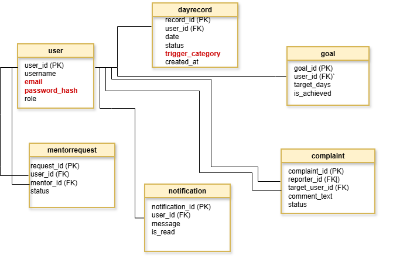

# Модель даних (Data Model)

## Реалізована початкова схема PostgreSQL

Міграція `0001_initial` створює `users`, `day_records` і `goals`.
Їхня фактична структура показана в
[implemented-data-model.puml](uml/implemented-data-model.puml).
Напої зберігаються як JSONB-масив усередині календарного запису; одна дата
користувача унікальна; час створення й оновлення має часовий пояс.
Зовнішні ключі забороняють запис/ціль без користувача, а CHECK-обмеження
перевіряють статус, сумісність тверезого дня з напоями й діапазон цілі.

ORM календарного запису, User ORM і PostgreSQL-маршрутизатори інтегровані.
Фіксовані етапи 7 і 30 днів обчислюються з календарної історії та не зберігаються
в окремій таблиці. Таблиця `goals` і її ORM залишені для сумісності з початковою
міграцією, але поточний застосунок не створює й не змінює її записи.
Подальші розділи описують цільову модель: MentorRequest, Notification і Complaint
цією міграцією не створюються.

[Налаштування й передача контрактів БД](../development/database-handoff.md).

Цей документ описує сутності, їхні зв'язки та чутливі дані вебзастосунку "Рехаб".

## 1. ER-модель 

## 2. Опис сутностей, зв'язків та кардинальності

* **User (Користувач)** — центральна сутність системи. Зберігає інформацію про ролі (`user`, `mentor`, `admin`), облікові дані та максимальний рекорд серії.
* **DayRecord (Запис у календарі)** — пов'язаний з `User` відношенням **1 до N**. Один користувач може створювати багато щоденних записів про свій стан. Зберігає статус дня (`sober` / `relapse`), дату, тригер зриву та час створення (`created_at`) для перевірки 48 годин на редагування.
* **Goal (Legacy-таблиця)** — збережена в початковій схемі БД для сумісності. Поточний застосунок не створює та не змінює її записи. Етапи 7 і 30 днів обчислюються з календарної історії.
* **MentorRequest (Запит на наставництво)** — зв'язує користувачів через два зовнішні ключі (`user_id` як підопічний та `mentor_id` як ментор) у відношенні **N до M** через проміжну сутність запиту, де керуються статуси (`pending`, `accepted`, `rejected`).
* **Notification (Сповіщення)** — пов'язане з `User` відношенням **1 до N**. Зберігає повідомлення, що надсилаються конкретному користувачу (наприклад, сповіщення ментора про зрив підопічного).
* **Complaint (Скарга)** — зв'язує двох користувачів: того, хто скаржиться (`reporter_id`), із тим, на кого подано скаргу (`target_user_id`), забезпечуючи зв'язок **N до 1** для кожного з учасників процесу модерації.

## 3. Чутливі та персональні дані (Sensitive Data)

У системі обробляються такі критичні дані, що вимагають особливого захисту (позначено червоним):
1. **Облікові дані:** адреси електронної пошти (`User.email`) та криптографічні хеші паролів (`User.password_hash`).
2. **Психологічний стан і статус тверезості:** дані про зриви (`DayRecord.status`) та категорії тригерів (`DayRecord.trigger_category`).
3. **Соціальні зв'язки та скарги:** інформація про менторство та скарги користувачів.
