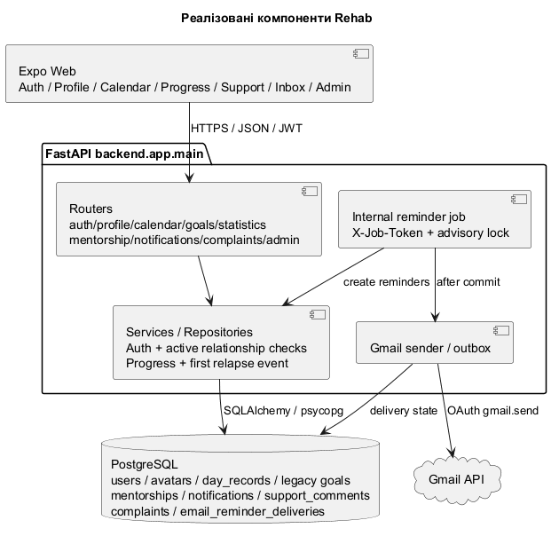
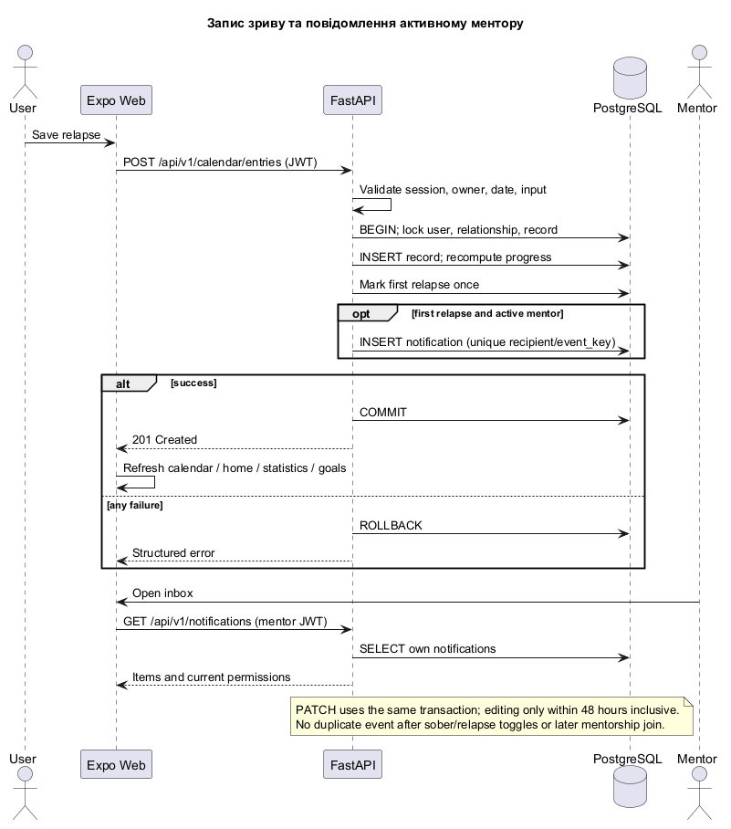
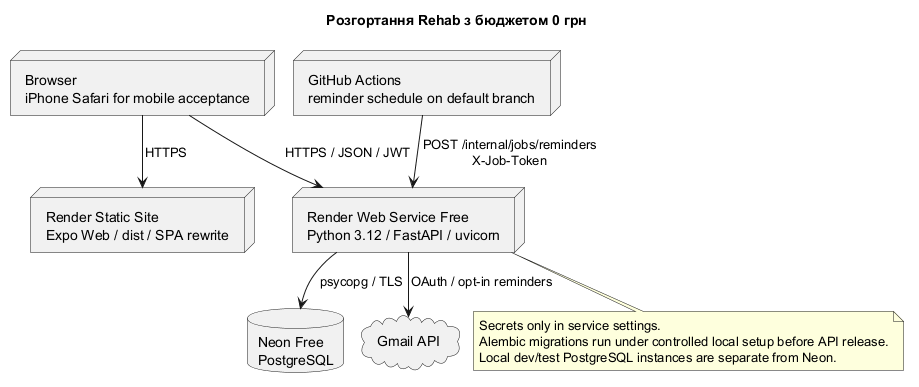

# Високорівнева архітектура Rehab

## Архітектурний стиль

Клієнт-серверна система з багатошаровим монолітом FastAPI: routers → services/repositories → SQLAlchemy/PostgreSQL. Expo Web спілкується зі спільним API-клієнтом через HTTPS/JSON і JWT. Основний застосунок — backend.app.main:app; історичний прототип не є сервером онлайн-версії.

## Компоненти

- Frontend: авторизація й відновлення сесії, ProfileProvider, календар, статистика, цілі, менторство, inbox, скарги та адмінка.
- Backend: auth/profile/mentorship/calendar/goals/statistics/notifications/complaints/admin і окремо захищений internal job.
- PostgreSQL: облікові записи, фото BYTEA, календар, зв’язки, повідомлення, підтримка, скарги та outbox. Міграції Alembic 0001_initial → 0002_team_foundation.
- Gmail sender: лише opt-in копії щоденних нагадувань; секрети зберігаються в середовищі backend.

## Транзакції та доступ

Запис календаря, перерахунок прогресу й emit_relapse_once фіксуються разом. Порядок блокувань: users (FOR NO KEY UPDATE) → mentorships → day_records/notifications/complaints. Перша подія не дублюється при повторній зміні статусу.

Роль не замінює право на ресурс. Ментор читає календар і статистику лише активного підопічного; після завершення чи схвалення скарги новий доступ і підтримка закриті. Історія зберігається. Адмін бачить скарги з доказом і агрегати; акаунти не блокуються.

Job серіалізується PostgreSQL advisory lock, створює inbox/outbox і робить commit перед зовнішнім надсиланням. Унікальні ключі захищають від повторів; невизначена доставка не повторюється сліпо.

## Узгодженість клієнта

POST/PATCH календаря повідомляє пов’язані екрани про зміну. Фокус і видимість оновлюють дані; запізніла відповідь іншого акаунта або періоду не підміняє поточний екран. Помилка запиту має окремий стан і повтор. Приватна навігація очікує відновлення сесії; прямі посилання обслуговує SPA rewrite.

## Розгортання та діаграми

Render Static Site (Expo dist), Render Web Service Free (FastAPI) та Neon Free (PostgreSQL через TLS). Локальні dev/test бази PostgreSQL 16 відокремлені. Тести не використовують онлайн-БД.

- [Компоненти](uml/component-diagram.puml)
- [Сценарій зриву](uml/sequence-diagram.puml)
- [Розгортання](uml/deployment-diagram.puml)
- [Модель даних](data-model.md)
- [Налаштування розгортання](../deployment/render-neon.md)

Зображення згенеровано з відповідних PlantUML-джерел:

