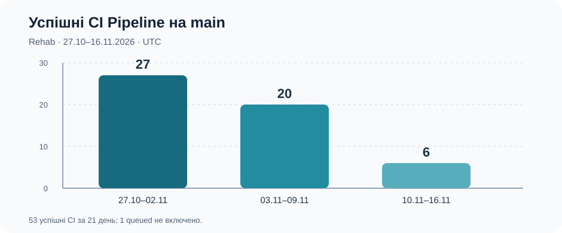

# Лабораторна робота №10 — аналіз DORA для Rehab

**Роль:** аналітик DORA (учасник №2).  
**Репозиторій:** [ukma-fin-ssdm-2026/Rehab](https://github.com/ukma-fin-ssdm-2026/Rehab).  
**Період:** 27 жовтня — 16 листопада 2026 року включно (21 повна доба, UTC).  
**Дата знімка GitHub API:** 17 листопада 2026 року.

## Методика та вибірка

Для навчального аналізу використано `CI Pipeline` (`.github/workflows/ci.yml`) з умовами `event=push`, `head_branch=main` та часом створення запуску в межах зазначеного періоду. Інші workflow, зокрема `Daily reminders`, `Publish API docs`, `Code Quality`, `Dependency Audit` і `Lab07 Traceability`, не враховуються як окремі поставки змін.

У вибірці **54 CI-запуски**: **53 завершилися успішно**, **0 завершилися помилкою**, **1 залишився у статусі `queued`**. Останній — [CI #43096573477](https://github.com/ukma-fin-ssdm-2026/Rehab/actions/runs/43096573477) для [PR #261](https://github.com/ukma-fin-ssdm-2026/Rehab/pull/261); це **не** невдалий запуск і він виключений зі знаменника частки збоїв та з розрахунків Lead Time.

**Межа інтерпретації:** у цій роботі успішний CI на `main` — **навчальний аналог доставки**, а не підтвердження реального розгортання на production. Звідси наведені показники є **CI-проксі чотирьох метрик DORA**, а не вимірюванням реальної експлуатаційної доступності.

## Результати

| Метрика | Розрахунок | Підсумок | Інтерпретація |
| --- | --- | --- | --- |
| Deployment Frequency (частота доставки) | 53 успішні CI / 21 день | **2,52 успішного CI/день** | Умовно висока частота інтеграцій, не production-релізів |
| Lead Time for Changes (час проходження змін) | Від першого коміту кожного PR до завершення успішного CI на його merge-коміті у `main`; 53 PR | **Медіана 1,44 год; середнє 15,91 год** | Середнє вище медіани через кілька довгих PR |
| Change Failure Rate (частка збоїв) | 0 завершених невдалих / (53 успішні + 0 невдалих) × 100% | **0,00%** | Частка невдалих *завершених CI*, не збоїв production |
| Time to Restore Service (час відновлення) | Від завершеного невдалого CI до наступного успішного CI | **Не визначається** | У вибірці немає завершених невдалих CI; це не дорівнює нулю |

Для першої метрики додатково: **53 / 3 = 17,67 успішного CI за тиждень у середньому**.

### Частота CI за тижнями

| Тиждень (UTC) | Успішні CI |
| --- | ---: |
| 27.10–02.11 | 27 |
| 03.11–09.11 | 20 |
| 10.11–16.11 | 6 |
| **Усього** | **53** |

### Розрахунок Lead Time

Для всіх **54 PR**, злитих у `main` за період, встановлено відповідність між `merge_commit_sha` і запуском `CI Pipeline` з `head_sha`. У **53 випадках** CI успішно завершився. Для кожного з них час початку — дата автора найранішого коміту зі списку комітів PR; час кінця — `updated_at` успішного workflow-run як наближення моменту його завершення. Дата першого коміту може бути ранішою за початок періоду, якщо PR злили протягом періоду.

**Медіана:** 1,44 год.  
**Середнє арифметичне:** 15,91 год.  
**Мінімум:** 0,03 год.  
**Максимум:** 129,53 год.  
**PR зі значенням понад 24 години:** 11 з 53.

Найдовші інтервали:

| PR | Lead Time | Доказ |
| --- | ---: | --- |
| [#242](https://github.com/ukma-fin-ssdm-2026/Rehab/pull/242) | 129,53 год | [CI #41885737560](https://github.com/ukma-fin-ssdm-2026/Rehab/actions/runs/41885737560) |
| [#153](https://github.com/ukma-fin-ssdm-2026/Rehab/pull/153) | 104,80 год | [CI #40541234601](https://github.com/ukma-fin-ssdm-2026/Rehab/actions/runs/40541234601) |
| [#206](https://github.com/ukma-fin-ssdm-2026/Rehab/pull/206) | 98,31 год | [CI #41622677189](https://github.com/ukma-fin-ssdm-2026/Rehab/actions/runs/41622677189) |

Інтервал охоплює не лише роботу CI, а й час між першим комітом, очікуванням review та злиттям PR. Тому він не є показником суто тривалості збірки. Детальний розрахунок кожного PR наведено в [таблиці Lead Time](./dora-pr-lead-time.csv).

## Орієнтовне зіставлення з DORA

За історичним орієнтиром [DORA 2024](https://dora.dev/research/2024/dora-report/2024-dora-accelerate-state-of-devops-report.pdf) декілька доставок на день і Lead Time менш як доба відповідають високій швидкості роботи (умовно рівень **Elite** за обома швидкісними показниками). Для цієї навчальної вибірки таке зіставлення **суто ілюстративне**, оскільки CI не є виробничим deployment. Нуль невдалих CI — позитивний результат автоматичних перевірок, але не доказ нульового production change fail rate. Для відновлення немає спостережень, тому відповідну категорію не призначено. **Загальну категорію команди DORA на підставі CI-проксі не встановлено.**

## Висновки за перевіреними даними

1. Протягом 21 дня було 53 підтверджені успішні CI на `main`, причому 27 припали на перший тиждень, 20 — на другий і 6 — на третій.
2. Час проходження змін нерівномірний: медіана 1,44 год помітно менша за середнє 15,91 год; істотний внесок мають довгі PR, наведені вище.
3. У вибірці немає завершених `failure` для `CI Pipeline` на `main`; один запуск залишився `queued`. Наявність такого запуску не слід приховувати і не слід помилково називати відновленням після інциденту.

## Джерела та перевірюваність

- [Всі 54 запуски CI на `main`](./dora-main-ci-runs.csv): час, статус, commit SHA, посилання на GitHub Actions.
- [Усі 54 PR з розрахунками](./dora-pr-lead-time.csv): перший коміт, merge, відповідний CI, час у годинах; у PR #261 обчислення не застосовується через `queued`.
- [Пошук Actions за періодом](https://github.com/ukma-fin-ssdm-2026/Rehab/actions/workflows/ci.yml?query=branch%3Amain+event%3Apush).
- [Приклад успішного CI #43262549761](https://github.com/ukma-fin-ssdm-2026/Rehab/actions/runs/43262549761) та [приклад незавершеного CI #43096573477](https://github.com/ukma-fin-ssdm-2026/Rehab/actions/runs/43096573477).

Під час збирання таблиць і перевірки формул використовувалися інструменти ШІ; першоджерелом усіх дат, статусів і посилань є GitHub.
