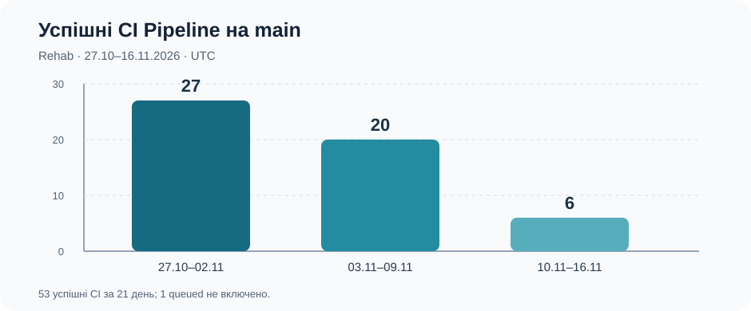

# Lab 10 — підсумок DORA для Rehab

**Період:** 27.10–16.11.2026 включно (21 день, UTC).  
**Джерела:** [первинні дані CI/CD](./metrics-raw.md), [докази запусків](./evidence/README.md), [план покращень](./improvement-plan.md), аналіз DORA в [PR #268](https://github.com/ukma-fin-ssdm-2026/Rehab/pull/268).  
**Дашборд:** [відкрити HTML-версію](./dora-dashboard.html).

## Визначення й вибірка

За визначенням лабораторної успішний зелений запуск на `main` є навчальним аналогом розгортання. Це CI-проксі, не підтвердження production-релізу.

У базовій вибірці враховано `CI Pipeline` для `push` у `main`: 54 коміти, 53 успішні запуски, 0 невдалих, 1 `queued` у знімку. У розширеній вибірці коміт успішний, якщо зелені і `CI Pipeline`, і `Code Quality`. За правилом одного запису на SHA маємо 51 успішний коміт, 2 невдалі, 1 незавершений. Один queued-коміт не зараховується як успіх чи збій.

## Чотири метрики

| Метрика | Лише CI Pipeline | CI Pipeline + Code Quality | Публікація образу в GHCR |
|---|---:|---:|---:|
| Частота розгортань (успішні коміти на тиждень) | 17,67 (53 / 3) | 17,00 (51 / 3) | Не виміряно |
| Час виконання змін, медіана | 1,44 год | 1,33 год | Не виміряно |
| Час виконання змін, середнє | 15,91 год | 14,03 год | Не виміряно |
| Частота збоїв змін | 0% (0 / 53) | 3,77% (2 / 53 завершені коміти) | Не виміряно |
| Час відновлення | Не визначається | 20,48 год — один інцидент | Не виміряно |

Lead time рахується від першого коміту PR до завершення успішних workflow на merge-коміті. Один SHA враховується один раз. Для CFR незавершений queued-коміт виключений зі знаменника.

Результат 0% стосується лише CI Pipeline. Додавання Code Quality виявляє два невдалі коміти й змінює CFR на 3,77%. У цій розширеній вибірці два червоні запуски належать до одного інциденту, тому 20,48 год — тривалість одного відновлення, а не середнє. Окрему категорію DORA не присвоєно: тут вимірюються CI-проксі, а не фактичні production-розгортання; для базової вибірки немає завершених невдалих запусків, з яких можна було б обчислити відновлення.

## Категорії DORA 2025

Шкала DORA 2025 показує рівень кожного показника та частку опитаних команд із таким самим або кращим результатом. Значення Rehab — навчальні CI-проксі, а не вимірювання production-розгортань.

| Метрика | Лише CI Pipeline | CI Pipeline + Code Quality |
|---|---|---|
| Частота розгортань | 17,67/тиждень — на вимогу, **16,2%** | 17/тиждень — на вимогу, **16,2%** |
| Lead Time (медіана) | 1,44 год — менше доби, **24,4%** | 1,33 год — менше доби, **24,4%** |
| Частота збоїв змін | 0% — інтервал 0–2%, **8,5%** | 3,77% — інтервал 2–4%, **16,7%** |
| Час відновлення | Не визначається | 20,48 год — менше доби, **56,5%** |

## Черга, виконання та час проходження змін

У 53 завершених CI-запусках черга виміряна від `run.created_at` до початку першого job, виконання — від початку першого до завершення останнього job. Паралельні jobs не підсумовувалися.

| Частина CI | Медіана | Частка сумарного часу CI |
| --- | ---: | ---: |
| Черга | **7 с** | **55,29%** |
| Виконання | **113 с** | **44,71%** |
| Час від створення CI до завершення | **116 с** | **100%** |

У сумі за період черга становила 7 643 с, а виконання — 6 181 с. Найдовша черга — **64,82 хв** у [PR #233](https://github.com/ukma-fin-ssdm-2026/Rehab/pull/233).

Для **повного Lead Time** 53 успішних PR: **99,54%** сумарного часу припадало на період від першого коміту до створення CI-запуску, **0,25%** — на чергу CI, **0,20%** — на виконання CI. Найбільше скорочення часу доставки дадуть швидше проходження PR та рівномірніші злиття; у межах самого CI важливе зменшення очікування спільного раннера.

### Орієнтири CircleCI

| Показник | Rehab | Рекомендований орієнтир | CircleCI 2025 |
| --- | ---: | ---: | ---: |
| Успішні завершені запуски на `main` | **100%** (53/53) | **90%** | **70,8%** |
| Відновлення зеленого стану `main` | **20,48 год** у розширеній вибірці; у базовій не визначається | **до 60 хв** | **59,2 хв** (медіана) |
| Медіана тривалості CI із чергою | **1 хв 56 с** | **до 10 хв** | **2,2 хв** (медіана) |

Відновлення 20,48 год — лише один підтверджений інцидент, а не медіана з кількох незалежних випадків.

## Графік частоти розгортань

## Швидкість і стабільність разом

За три тижні базова вибірка містить 53 успішні CI, розширена — 51 повністю зелений коміт. Тижневі значення базової вибірки: 27, 20 і 6; розширеної: 25, 20 і 6. Отже, частота залежить від того, які перевірки входять у визначення зеленого коміту. Зміни лише в документації після PR #272 не запускають workflow на `main`; ця зміна відбулася після вимірюваного періоду й не змінює його заднім числом.

Медіана lead time становить 1,44 год, а середнє — 15,91 год. За фазовим аналізом 72,5% сумарного часу припадає на період від відкриття PR до злиття; медіана від відкриття PR до першої рецензії — 0,43 год, а у 8 із 53 PR час від відкриття до злиття перевищив добу. Причини затримки конкретних PR не встановлені, тому це привід перевірити командні домовленості, а не висновок про мотиви учасниць.

Черга для цілого CI-запуску має медіану 7 секунд, виконання — 113 секунд. Це окремі інтервали від часу виконання змін. У метриках по окремих jobs інша одиниця вибірки: медіани 21 секунду в черзі та 106,5 секунди виконання на 84 jobs. Ці набори не слід змішувати.

## Який біль у нашій команді показали ці метрики?

- **Робота зливається нерівномірно.** 28 із 53 злиттів припали на два дні. За планом команди пропонується зливати готові й перевірені невеликі PR протягом тижня.
- **Основна частина довгого lead time — до злиття.** 72,5% сумарного часу PR припадає на час після відкриття й до злиття, хоча перша рецензія зазвичай відбувалася швидко. Для окремих довгих PR причини затримки не доведені.
- **Стабільність залежить від охоплення перевірками.** У Code Quality зафіксовано червоні запуски через форматування `backend/app/services/progress.py`. Після виправлення у [PR #157](https://github.com/ukma-fin-ssdm-2026/Rehab/pull/157) перевірки знову стали зеленими. У базовому CFR цей workflow не враховано; розширений підрахунок враховує обидва workflow один раз на коміт.
- **Є ризик завислих перевірок.** Запуски для PR #261 були `queued` у знімку й не підтверджували зеленого стану. Це не збій у розрахунку CFR, але потребує перевірки статусу запуску.

## План покращень

Дії й відповідальні наведені в командному плані. У команді з чотирьох осіб це пропозиції, а не доручення виконати їх зараз.

| Дія | Відповідальна | Стан |
|---|---|---|
| Зливати готові перевірені PR протягом тижня | @kyrychata | Пропозиція |
| Окремо показувати документаційні злиття в аналізі частоти | @Sof222 | Пропозиція |
| Призначати рецензентку під час відкриття PR; ціль першої рецензії — до 24 год | @maryxseee | Пропозиція |
| `concurrency` для застарілих запусків PR і `paths-ignore` для документаційних push | @Sof222 | Реалізовано у PR #272; вимірювання ефекту триває |
| Швидкий набір на PR і повільний після злиття | @maryxseee | Реалізовано у PR #271 |
| Узгодити розрахунок за CI Pipeline + Code Quality, один SHA — один запис | @kyrychata | Пропозиція; розширений розрахунок наведено вище |
| Встановити наявний pre-commit з Black | @maryxseee | Пропозиція |
| Не зливати PR із червоною перевіркою | @morozovap | Пропозиція |
| Чергування за станом `main`; реагувати на червоний стан | @kyrychata | Пропозиція |
| Щотижня перевіряти `queued` довше години | @Sof222 | Пропозиція |

Реалізація PR #272 ще не означає завершене вимірювання бонусу 2: таблиця «після» у [звіті бонусу](./bonus2-ci-runners.md) очікує щонайменше три (бажано п’ять) злиття зі змінами в коді, тестах або конфігурації.

## Докази

- [Первинна таблиця запусків](./metrics-raw.md) містить посилання на кожен запуск і JSON-доказ.
- [Папка evidence](./evidence/) містить експорт та докази запусків.
- [PR #268](https://github.com/ukma-fin-ssdm-2026/Rehab/pull/268) містить таблиці й методику аналітикині DORA, включно з розширеною перевіркою Code Quality.
- [PR #271](https://github.com/ukma-fin-ssdm-2026/Rehab/pull/271) і [PR #272](https://github.com/ukma-fin-ssdm-2026/Rehab/pull/272) підтверджують реалізовані зміни CI.

## Бонуси

- **№1 — автоматичний підрахунок DORA:** [скрипт](../../scripts/dora_metrics.py) через GitHub REST API рахує чотири метрики за вказаний період, окремо показує чергу й виконання повних CI-запусків та формує [результат](./dora-auto-results.md). [API-знімок](./evidence/dora-auto-api-snapshot.json) зберігає вихідні дані; автоматичні показники узгоджені з ручним розрахунком. Локальний запуск без розкладу: `python scripts/dora_metrics.py --snapshot docs/ci-cd/evidence/dora-auto-api-snapshot.json --output docs/ci-cd/dora-auto-results.md`.
- **№2 — економія запусків:** [PR #272](https://github.com/ukma-fin-ssdm-2026/Rehab/pull/272) злитий. Вимірювання «після» очікує 3–5 злиттів із кодом, тестами або конфігурацією; див. [звіт](./bonus2-ci-runners.md).
- **№3 — рівні тестів:** [реалізація](https://github.com/ukma-fin-ssdm-2026/Rehab/pull/271), перевірені PR/main запуски й докази в [звіті](./bonus-test-tiers.md).
- **№4 — нестабільні тести:** [workflow run #44313164492](https://github.com/ukma-fin-ssdm-2026/Rehab/actions/runs/44313164492) і результати п’яти повторів у [звіті](./bonus-flaky-tests.md).
- **№5 — образ у GHCR:** [Dockerfile](../../Dockerfile) і [workflow публікації](../../.github/workflows/publish-ghcr.yml) злиті в [PR #275](https://github.com/ukma-fin-ssdm-2026/Rehab/pull/275). Після успішного CI на `main` образ опубліковано у [GHCR](https://github.com/ukma-fin-ssdm-2026/Rehab/pkgs/container/rehab) з тегом повного SHA `4da0517428c806d70831f89dd1d9c8ef3c9f5ac6`. [Успішний запуск #44343800119](https://github.com/ukma-fin-ssdm-2026/Rehab/actions/runs/44343800119) зафіксував manifest digest `sha256:1e28601b31bdb2d28c0ca01c31f3fb5dba996d4093570420bcf4877d97a3f451`. Для цього самого коміту CI завершився за 49 хв 07 с (0,82 год) від першого коміту PR, а публікація образу — за 51 хв 05 с (0,85 год); різниця — 1 хв 58 с. Це початкове спостереження `n=1`: по одному успішному CI та випуску, CFR 0/1 = 0% в обох вибірках, час відновлення не визначається. Воно не є репрезентативною довгостроковою оцінкою. За період 27.10–16.11.2026 workflow ще не діяв, тому GHCR-метрики в таблиці залишаються «Не виміряно» і не екстраполюються заднім числом.
