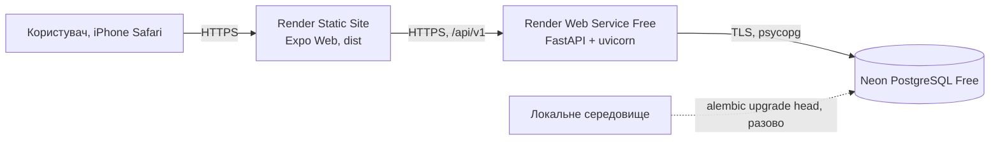

<!-- AI-GENERATED START -->
# Онлайн-розгортання Rehab: Render + Neon (бюджет 0 грн)

**Статус:** онлайн-середовище створено 29.10.2026 з гілки `codex/midterm-admin-deploy-sofiia`. Міграції в Neon ще не застосовано, тому реєстрація й робота з даними онлайн поки не перевірені. Розділ 6 заповнюється лише фактичними результатами.

| Компонент | Адреса |
|---|---|
| Frontend | https://rehab-web-b9d5.onrender.com |
| API | https://rehab-api-0na0.onrender.com |
| БД | Neon, проєкт Rehab (`rough-lake-01450787`), гілка `production`, AWS Europe Central 1 (Frankfurt), Free |

Власниця акаунтів Render і Neon — Софія; Поліна має доступ до Neon-проєкту з роллю Editor.

## 1. Схема розгортання



| Компонент | Сервіс і тариф | Файл конфігурації |
|---|---|---|
| Frontend | Render Static Site | `render.yaml` (`rehab-web`), `frontend/app.json` (`web.output: "single"`) |
| Backend | Render Web Service, Free | `render.yaml` (`rehab-api`) |
| БД | Neon, Free | міграції `alembic/` |

Платні ресурси не вмикаємо.

## 2. Змінні середовища

Значення вводяться лише в панелі сервісів. У Git, PR, чат і `EXPO_PUBLIC_*` (крім публічної адреси API) їх не додаємо.

| Змінна | Де | Значення |
|---|---|---|
| `DATABASE_URL` | API | рядок з Neon (Connect), у якому початок `postgresql://` замінено на `postgresql+psycopg://`; `?sslmode=require` залишити. Інший префікс `backend/app/core/config.py` відхиляє |
| `JWT_SECRET` | API | випадковий, ≥ 32 символи (Render генерує через `generateValue`) |
| `CORS_ORIGINS` | API | точна HTTPS-адреса frontend, без `/` в кінці; кілька адрес через кому |
| `EXPO_PUBLIC_API_URL` | Frontend | HTTPS-адреса API **без** `/api/v1`; після зміни потрібна нова збірка |
| `PYTHON_VERSION` / `NODE_VERSION` | API / Frontend | `3.12.8` / `22.13.0` (задано в `render.yaml`) |

`APP_ENV` код зараз **не читає**, тому його не задаємо. Перевірено пошуком по `backend/`: використовуються лише `DATABASE_URL`, `TEST_DATABASE_URL` (тільки тести), `JWT_SECRET`, `CORS_ORIGINS`.

CORS: дозволені методи `GET, POST, PATCH, PUT, DELETE, OPTIONS`, заголовки `Authorization` і `Content-Type` (тести: `tests/test_health.py`).

## 3. Порядок розгортання

1. **Neon (Поліна):** створити окрему БД для онлайн-версії, скопіювати рядок підключення в менеджер секретів команди.
2. **Міграції (одноразово, з підготовленого локального середовища)**, з кореня репозиторію, з адресою онлайн-БД у `DATABASE_URL`:
   ```bash
   python -m alembic upgrade head
   ```
   Для міграцій брати прямий рядок Neon (Connect → вимкнути Connection pooling, хост без `-pooler`); для API на Render — pooled.
   На Free немає окремого release-кроку, тому міграції запускаються вручну перед відповідною версією API. Тести й очищення даних виконуються лише в тестовій БД, онлайн-БД для pytest не використовується.
3. **Render API:** Blueprint із `render.yaml` або вручну; задати `DATABASE_URL`, `CORS_ORIGINS`.
4. **Render Static Site:** задати `EXPO_PUBLIC_API_URL` адресою API, запустити збірку.
5. Після появи адреси frontend повернутися до кроку 3 і вказати її в `CORS_ORIGINS`.
6. Створити адміна й демо-дані: `scripts/seed_demo.py` (паролі лише зі змінних `SEED_*`, див. заголовок скрипта).

## 4. Обмеження Free

Render присипляє API після 15 хвилин без запитів, пробудження займає близько хвилини: систему відкриваємо завчасно перед перевіркою й захистом. Neon Free має ліміти ресурсів, використання потрібно контролювати.

## 5. Хто за що відповідає

Софія: Render, конфіг, CORS, `/health`, `/ready`, документація. Поліна: Neon і міграції. Анастасія: перевірка авторизації й клієнта на публічних адресах. Марія: підключення своїх модулів. Власниць акаунтів і спосіб командного доступу вписує команда тут: _не заповнено_.

## 6. Результати перевірок (заповнюється фактично)

| Перевірка | Результат | Дата |
|---|---|---|
| `GET /health` онлайн | `{"status":"ok"}` | 29.10.2026 |
| `GET /ready` онлайн | `{"status":"ok","database":"ok"}` — підключення до Neon є | 29.10.2026 |
| Frontend відкривається | екран входу відображається | 29.10.2026 |
| Реєстрація → вхід → `/me` | _не виконано_ | |
| Календар зберігається після перезапуску | _не виконано_ | |
| Цілі, статистика, перерахунок | _не виконано_ | |
| Ізоляція користувачів | _не виконано_ | |
| Вихід і блокування (admin) | _не виконано_ | |
| iPhone Safari: форми, навігація, прямі посилання, перезавантаження | _не виконано_ (модель і версія iOS: _?_) | |

Android не входить до перевірок і не вказується як перевірений.
<!-- AI-GENERATED END -->
