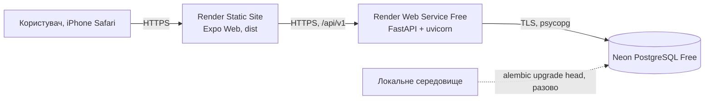

# Онлайн-розгортання Rehab: Render + Neon

Код усіх модулів інтегровано в develop. Фактичний онлайн-SHA, застосування 0002_team_foundation та реальну доставку Gmail потрібно підтвердити окремо; попередня перевірка 29.10.2026 цього не доводить. Сценарії — [тест-план](../validation/test-plan.md).

| Компонент | Адреса |
|---|---|
| Frontend | https://rehab-web-b9d5.onrender.com |
| API | https://rehab-api-0na0.onrender.com |
| БД | Neon, проєкт Rehab (`rough-lake-01450787`), гілка `production`, AWS Europe Central 1 (Frankfurt), Free |

Власниця акаунтів Render і Neon — Софія; Поліна має доступ до Neon-проєкту з роллю Editor.

## 1. Схема розгортання



| Компонент | Сервіс і тариф | Файл конфігурації |
|---|---|---|
| Frontend | Render Static Site | `render.yaml` (`rehab-web`), `frontend/app.json` (`web.output: "single"`) |
| Backend | Render Web Service, Free | `render.yaml` (`rehab-api`) |
| БД | Neon, Free | міграції `alembic/` |

Платні ресурси не вмикаємо. Для інтегрованої версії потрібна `0002_team_foundation`; поточний Alembic head — 0002_team_foundation.

## 2. Змінні середовища

Значення вводяться лише в панелі сервісів. У Git, PR, чат і `EXPO_PUBLIC_*` (крім публічної адреси API) їх не додаємо.

| Змінна | Де | Значення |
|---|---|---|
| `DATABASE_URL` | API | рядок з Neon (Connect), у якому початок `postgresql://` замінено на `postgresql+psycopg://`; `?sslmode=require` залишити. Інший префікс `backend/app/core/config.py` відхиляє |
| `JWT_SECRET` | API | випадковий, ≥ 32 символи (Render генерує через `generateValue`) |
| `CORS_ORIGINS` | API | точна HTTPS-адреса frontend, без `/` в кінці; кілька адрес через кому |
| `EXPO_PUBLIC_API_URL` | Frontend | HTTPS-адреса API **без** `/api/v1`; після зміни потрібна нова збірка |
| `PYTHON_VERSION` / `NODE_VERSION` | API / Frontend | `3.12.8` / `22.13.0` (задано в `render.yaml`) |

`APP_ENV` код не читає. Додаткові змінні нагадувань наведено у розділі 7; жоден поштовий секрет не передається frontend.

CORS: дозволені методи `GET, POST, PATCH, PUT, DELETE, OPTIONS`, заголовки `Authorization` і `Content-Type` (тести: `tests/test_health.py`).

## 3. Порядок розгортання

1. **Відновлення:** перед production-міграцією створити перевірену контрольну точку/копію; тестові прогони виконувати окремо.
2. **Neon:** використовувати наявний проєкт Софії `rough-lake-01450787`, гілку `production`, БД `neondb`. Новий проєкт чи другу онлайн-БД не створювати. Доступ Поліни наданий через запрошення до організації.
2. **Міграції (одноразово, з підготовленого локального середовища)**, з кореня репозиторію, з адресою онлайн-БД у `DATABASE_URL`:
   ```bash
   python -m alembic upgrade head
   ```
   Для міграцій брати прямий рядок Neon (Connect → вимкнути Connection pooling, хост без `-pooler`); для API на Render — pooled.
   На Free немає окремого release-кроку, тому міграції запускаються вручну перед відповідною версією API. Тести й очищення даних виконуються лише в тестовій БД, онлайн-БД для pytest не використовується.
3. **Render API:** Blueprint із `render.yaml` або вручну; задати `DATABASE_URL`, `CORS_ORIGINS`.
4. **Render Static Site:** задати `EXPO_PUBLIC_API_URL` адресою API, запустити збірку.
5. Після появи адреси frontend повернутися до кроку 3 і вказати її в `CORS_ORIGINS`.
6. Створити адміна й демо-дані: `python -m scripts.seed_demo` з кореня репозиторію, з прямим (без `-pooler`) рядком Neon у `DATABASE_URL` (паролі лише зі змінних `SEED_*`, див. заголовок скрипта).

## 4. Обмеження Free

Render присипляє API після 15 хвилин без запитів, пробудження займає близько хвилини: систему відкриваємо завчасно перед перевіркою й захистом. Neon Free має ліміти ресурсів, використання потрібно контролювати.

## 5. Хто за що відповідає

Софія: Render, конфіг, CORS, `/health`, `/ready`, документація. Поліна: Neon і міграції. Анастасія: перевірка авторизації й клієнта на публічних адресах. Марія: підключення своїх модулів. Власниця Render/Neon — Софія; доступ Поліни до Neon надано через запрошення Editor. Особисті паролі не передаються.

## 6. Перевірка розгортання

Перед релізом зафіксувати SHA API/frontend, alembic current, /health, /ready, результати сценаріїв тест-плану, дату й пристрій. Командні перевірки 29.10.2026 підтверджували попередню онлайн-версію: auth, календар після перезапуску, SPA reload та Safari. Вони не підтверджують нові менторство/скарги/пошту, п’ять етапів і стилі.

Мобільне приймання — тільки iPhone/Safari; Android не позначається перевіреним. Gmail OAuth та фактичний лист підтверджує власниця окремо. Власні тести не виконуються на онлайн-БД.

## 7. Gmail і ручний запуск нагадувань

Поточний факт: командою підтверджено, що OAuth ще не налаштовували.
Створення inbox/outbox та обробка доставок перевіряються локально з підмінним
sender; це не є підтвердженням отримання справжнього листа.

### Одноразове налаштування власницею скриньки

1. У Google Cloud вибрати командний проєкт, увімкнути Gmail API, налаштувати
   OAuth consent та створити OAuth client типу Desktop app. Авторизується
   тільки `rehab.support.web@gmail.com`, не користувачі Rehab.
2. Дозволити лише scope `https://www.googleapis.com/auth/gmail.send`.
   Завантажити client JSON поза репозиторієм. Якщо застосунок у Testing,
   додати командну адресу до test users. Для Gmail refresh token у Testing
   має 7-денний строк; для подальшої роботи узгодити допустимий publishing status
   та повторно отримати токен, не заявляючи про верифікацію без її проходження.
3. Локально встановити інструмент авторизації та запустити:

   ```powershell
   .venv/Scripts/python.exe -m pip install google-auth-oauthlib==1.5.0
   .venv/Scripts/python.exe scripts/authorize_gmail.py authorize --client-secrets "$HOME/Downloads/client_secret.json"
   ```

   Вхід у Google та надання дозволу виконує власниця. Результат за замовчуванням
   у `~/.rehab/gmail-oauth.json`, поза Git. Не надсилати цей файл у чат/PR.
4. Перенести значення в Render API Environment: `GMAIL_CLIENT_ID`,
   `GMAIL_CLIENT_SECRET`, `GMAIL_REFRESH_TOKEN`, `MAIL_FROM=rehab.support.web@gmail.com`.
   Додати випадковий `REMINDERS_JOB_TOKEN` щонайменше 32 символи.
5. Через приватні environment-змінні запустити технічний лист:

   ```powershell
   .venv/Scripts/python.exe scripts/authorize_gmail.py test-send --to rehab.support.web@gmail.com
   ```

   Скрипт робить дві відправки з окремими sender, перевіряючи оновлення access token.
   Власниця перевіряє фактичне отримання у пошті. Зафіксувати дату й результат
   без токенів. Після перенесення секретів прибрати тимчасові приватні JSON.

Google: [Gmail Python quickstart](https://developers.google.com/workspace/gmail/api/quickstart/python),
[строки OAuth refresh token](https://developers.google.com/identity/protocols/oauth2).

### Job і розклад

Після 20:00 Europe/Kyiv job створює одне нагадування за поточну дату лише
за відсутності явного календарного запису; email додається тільки при opt-in.
Зриви й авторські коментарі на пошту не надсилаються. До 20:00 нуль створених
нагадувань — очікуваний результат. Production endpoint не приймає довільний час.

Для ручного HTTPS-запуску після розгортання налаштувати приватні environment
`REHAB_API_URL` і `REMINDERS_JOB_TOKEN`, потім:

```powershell
.venv/Scripts/python.exe scripts/run_reminders_job.py
```

У Actions secrets потрібні тільки ці дві змінні; Gmail/БД там не потрібні.
`.github/workflows/reminders.yml` має cron 17–21 UTC кожні 15 хвилин,
ubuntu-latest і concurrency. Schedule запрацює з default branch після
погодженого main; до цього перевіряємо ручний endpoint, не зливаємо main заради таймера.
Фактичний запуск може затримуватися. Завислий/невизначений лист → unknown,
без сліпого повтору. Вимкнення пошти або явний запис скасовують ще не надіслану копію.
