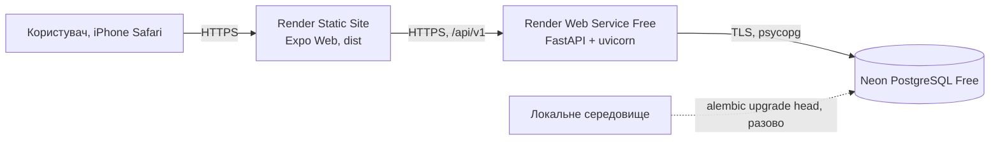

# Онлайн-розгортання Rehab: Render + Neon

Код усіх модулів інтегровано в develop. За звітом Софії від 01.11.2026 backend розгорнуто з f9110bc, frontend — з 0ab8f53; міграція 0002_team_foundation застосована 31.10.2026, Gmail OAuth і два технічні листи перевірені 30.10.2026. Job на Render, лист від job та збереження після перезапуску нового API ще не перевірені. Сценарії — [тест-план](../validation/test-plan.md).

Отримано ручний звіт Марії 01.11.2026: календар, перерахунок, менторство, підтримка, скарги, профіль і вихід перевірені в Safari на обох iPhone; додатково повідомлено про той самий набір M01–M25 на Xiaomi Mi 11 / Android 16 у Chrome. Підтверджена адреса — https://rehab-web-b9d5.onrender.com. Пристрої, точні межі й непідтверджені пункти — у [протоколі тест-плану](../validation/test-plan.md#ручний-командний-звіт-марії--отримано-01112026). Софія повідомила поточні SHA: API f9110bc, frontend 0ab8f53. Отримання листа саме від job та перезапуск нового API не підтверджені; технічні test-send листи підтверджені окремо.

| Компонент | Адреса |
|---|---|
| Frontend | https://rehab-web-b9d5.onrender.com |
| API | https://rehab-api-0na0.onrender.com |
| БД | Neon, проєкт Rehab (`rough-lake-01450787`), гілка `production`, AWS Europe Central 1 (Frankfurt), Free |

Власниця акаунтів Render і Neon — Софія; Поліна має доступ до Neon-проєкту з роллю Editor.

## 1. Схема розгортання



| Компонент | Сервіс і тариф | Файл конфігурації |
|---|---|---|
| Frontend | Render Static Site | `render.yaml` (`rehab-web`), `frontend/app.json` (`web.output: "single"`) |
| Backend | Render Web Service, Free | `render.yaml` (`rehab-api`) |
| БД | Neon, Free | міграції `alembic/` |

Платні ресурси не вмикаємо. Для інтегрованої версії потрібна `0002_team_foundation`; поточний Alembic head — 0002_team_foundation.

## 2. Змінні середовища

Значення вводяться лише в панелі сервісів. У Git, PR, чат і `EXPO_PUBLIC_*` (крім публічної адреси API) їх не додаємо.

| Змінна | Де | Значення |
|---|---|---|
| `DATABASE_URL` | API | рядок з Neon (Connect), у якому початок `postgresql://` замінено на `postgresql+psycopg://`; `?sslmode=require` залишити. Інший префікс `backend/app/core/config.py` відхиляє |
| `JWT_SECRET` | API | випадковий, ≥ 32 символи (Render генерує через `generateValue`) |
| `CORS_ORIGINS` | API | точна HTTPS-адреса frontend, без `/` в кінці; кілька адрес через кому |
| `EXPO_PUBLIC_API_URL` | Frontend | HTTPS-адреса API **без** `/api/v1`; після зміни потрібна нова збірка |
| `PYTHON_VERSION` / `NODE_VERSION` | API / Frontend | `3.12.8` / `22.13.0` (задано в `render.yaml`) |

`APP_ENV` код не читає. Додаткові змінні нагадувань наведено у розділі 7; жоден поштовий секрет не передається frontend.

CORS: дозволені методи `GET, POST, PATCH, PUT, DELETE, OPTIONS`, заголовки `Authorization` і `Content-Type` (тести: `tests/test_health.py`).

## 3. Порядок розгортання

1. **Відновлення:** перед production-міграцією створити перевірену контрольну точку/копію; тестові прогони виконувати окремо.
2. **Neon:** використовувати наявний проєкт Софії `rough-lake-01450787`, гілку `production`, БД `neondb`. Новий проєкт чи другу онлайн-БД не створювати. Доступ Поліни наданий через запрошення до організації.
2. **Міграції (одноразово, з підготовленого локального середовища)**, з кореня репозиторію, з адресою онлайн-БД у `DATABASE_URL`:
   ```bash
   python -m alembic upgrade head
   ```
   Для міграцій брати прямий рядок Neon (Connect → вимкнути Connection pooling, хост без `-pooler`); для API на Render — pooled.
   На Free немає окремого release-кроку, тому міграції запускаються вручну перед відповідною версією API. Тести й очищення даних виконуються лише в тестовій БД, онлайн-БД для pytest не використовується.
3. **Render API:** Blueprint із `render.yaml` або вручну; задати `DATABASE_URL`, `CORS_ORIGINS`.
4. **Render Static Site:** задати `EXPO_PUBLIC_API_URL` адресою API, запустити збірку.
5. Після появи адреси frontend повернутися до кроку 3 і вказати її в `CORS_ORIGINS`.
6. Створити адміна й демо-дані: `python -m scripts.seed_demo` з кореня репозиторію, з прямим (без `-pooler`) рядком Neon у `DATABASE_URL` (паролі лише зі змінних `SEED_*`, див. заголовок скрипта).

## 4. Обмеження Free

Render присипляє API після 15 хвилин без запитів, пробудження займає близько хвилини: систему відкриваємо завчасно перед перевіркою й захистом. Neon Free має ліміти ресурсів, використання потрібно контролювати.

## 5. Хто за що відповідає

Софія: Render, конфіг, CORS, `/health`, `/ready`, документація. Поліна: Neon і міграції. Анастасія: перевірка авторизації й клієнта на публічних адресах. Марія: підключення своїх модулів. Власниця Render/Neon — Софія; доступ Поліни до Neon надано через запрошення Editor. Особисті паролі не передаються.

## 6. Перевірка розгортання

Перед релізом зафіксувати SHA API/frontend, alembic current, /health, /ready, результати сценаріїв тест-плану, дату й пристрій. Командні перевірки 29.10.2026 підтверджували попередню онлайн-версію: auth, календар після перезапуску, SPA reload та Safari. Вони не підтверджують нові менторство/скарги/пошту, п’ять етапів і стилі.

Погоджене мобільне приймання — iPhone/Safari; додатковий ручний звіт Xiaomi/Chrome зберігається окремо в тест-плані. Gmail OAuth та фактичний лист підтверджує власниця окремо. Власні тести не виконуються на онлайн-БД.

## 7. Gmail і ручний запуск нагадувань

Поточний стан за звітом Софії: OAuth налаштовано 30.10.2026 для командної скриньки, два test-send листи фактично отримано, включно з повторним отриманням access token. Це підтверджує поштовий транспорт, але не виконання Render job або автоматичного розкладу. Налаштування нижче наведено для відтворення; повторна авторизація не потрібна лише заради документації.

### Інструкція первинного налаштування власницею скриньки

1. У Google Cloud вибрати командний проєкт, увімкнути Gmail API, налаштувати
   OAuth consent та створити OAuth client типу Desktop app. Авторизується
   тільки `rehab.support.web@gmail.com`, не користувачі Rehab.
2. Дозволити лише scope `https://www.googleapis.com/auth/gmail.send`.
   Завантажити client JSON поза репозиторієм. Якщо застосунок у Testing,
   додати командну адресу до test users. Для Gmail refresh token у Testing
   має 7-денний строк; для подальшої роботи узгодити допустимий publishing status
   та повторно отримати токен, не заявляючи про верифікацію без її проходження.
3. Локально встановити інструмент авторизації та запустити:

   ```powershell
   .venv/Scripts/python.exe -m pip install google-auth-oauthlib==1.5.0
   .venv/Scripts/python.exe scripts/authorize_gmail.py authorize --client-secrets "$HOME/Downloads/client_secret.json"
   ```

   Вхід у Google та надання дозволу виконує власниця. Результат за замовчуванням
   у `~/.rehab/gmail-oauth.json`, поза Git. Не надсилати цей файл у чат/PR.
4. Перенести значення в Render API Environment: `GMAIL_CLIENT_ID`,
   `GMAIL_CLIENT_SECRET`, `GMAIL_REFRESH_TOKEN`, `MAIL_FROM=rehab.support.web@gmail.com`.
   Додати випадковий `REMINDERS_JOB_TOKEN` щонайменше 32 символи.
5. Через приватні environment-змінні запустити технічний лист:

   ```powershell
   .venv/Scripts/python.exe scripts/authorize_gmail.py test-send --to rehab.support.web@gmail.com
   ```

   Скрипт робить дві відправки з окремими sender, перевіряючи оновлення access token.
   Власниця перевіряє фактичне отримання у пошті. Зафіксувати дату й результат
   без токенів. Після перенесення секретів прибрати тимчасові приватні JSON.

Google: [Gmail Python quickstart](https://developers.google.com/workspace/gmail/api/quickstart/python),
[строки OAuth refresh token](https://developers.google.com/identity/protocols/oauth2).

### Job і розклад

Після 20:00 Europe/Kyiv job створює одне нагадування за поточну дату лише
за відсутності явного календарного запису; email додається тільки при opt-in.
Зриви й авторські коментарі на пошту не надсилаються. До 20:00 нуль створених
нагадувань — очікуваний результат. Production endpoint не приймає довільний час.

Для ручного HTTPS-запуску після розгортання налаштувати приватні environment
`REHAB_API_URL` і `REMINDERS_JOB_TOKEN`, потім:

```powershell
.venv/Scripts/python.exe scripts/run_reminders_job.py
```

У Actions secrets потрібні тільки ці дві змінні; Gmail/БД там не потрібні.
`.github/workflows/reminders.yml` має cron 17–21 UTC кожні 15 хвилин,
ubuntu-latest і concurrency. Schedule запрацює з default branch після
погодженого main; до цього перевіряємо ручний endpoint, не зливаємо main заради таймера.
Фактичний запуск може затримуватися. Завислий/невизначений лист → unknown,
без сліпого повтору. Вимкнення пошти або явний запис скасовують ще не надіслану копію.

## Незалежна перевірка відкритих даних — 01.11.2026

Перевірив агент із цього ноутбука, окремо від ручного звіту Марії. Дані отримано близько 14:02 Europe/Kyiv; облікові записи, налаштування й онлайн-дані не змінювалися.

| Об’єкт | Фактичний результат |
|---|---|
| [API /health](https://rehab-api-0na0.onrender.com/health) | HTTP 200, status=ok |
| [API /ready](https://rehab-api-0na0.onrender.com/ready) | HTTP 200, status=ok, database=ok; це підтверджує доступність БД, не Alembic revision |
| [Публічна OpenAPI](https://rehab-api-0na0.onrender.com/openapi.json) | HTTP 200, 33 шляхи; весь JSON структурно збігається з docs/api/openapi-generated.yaml поточного develop |
| [Frontend](https://rehab-web-b9d5.onrender.com) | HTTP 200; Last-Modified 31.10.2026 20:24:40 UTC |
| Останній Render API deployment у GitHub | [7472219996](https://api.github.com/repos/ukma-fin-ssdm-2026/Rehab/deployments/7472219996/statuses): success 01.11.2026 11:17:28 UTC (13:17:28 Kyiv), dep-dbjhusnavr4c73c2p1rg |
| Останній Render frontend deployment у GitHub | [7463935060](https://api.github.com/repos/ukma-fin-ssdm-2026/Rehab/deployments/7463935060/statuses): success 31.10.2026 20:24:40 UTC (22:24:40 Kyiv), dep-dbj4sjrm8hqs73fek7tg |
| SHA в GitHub deployment metadata | Обидва записи називають e09aefe48e867078155ac5205028cc7473845230, ref codex/midterm-admin-deploy-sofiia. Це старий документаційний коміт 29.10, тоді як онлайн OpenAPI збігається з новим develop. Метадані не використовуються як доведений SHA фактично зібраного коду |
| GitHub reminder schedule | У поточному main b1eab19 немає .github/workflows/reminders.yml; [перелік workflows](https://api.github.com/repos/ukma-fin-ssdm-2026/Rehab/actions/workflows) містить лише CI, Code Quality, Dependency Audit, Publish API docs і Lab07 Traceability. Запит історії reminders.yml повертає 404. Розклад через описаний GitHub workflow ще не активний; можливий сторонній планувальник не перевірено |
| Render / Neon dashboard | Обидві панелі показують вхід; авторизованої сесії на цьому ноутбуці немає. Проєктний .env також відсутній; пряме читання онлайн-БД неможливе |

Цією незалежною перевіркою агент сам не підтвердив build SHA, Alembic revision або Gmail у закритих панелях. Пізніше Софія надала окремий командний звіт про ці налаштування й технічні листи (нижче). Збереження після перезапуску та лист від Render job залишаються неперевіреними. Для цього потрібні авторизовані панелі/командний доступ, а не висновок із /ready або успіху тестів. Перезапуск і надсилання листів не виконувалися.

## Командний звіт Софії — передано Марією 01.11.2026

Джерело цього розділу — повідомлення Софії, передане Марією в чаті. Воно доповнює відкриті перевірки агента; доступ до закритих панелей агент цим записом не заявляє. Час розгортань нижче — Europe/Kyiv.

| Об’єкт | Повідомлений результат |
|---|---|
| Backend rehab-api | [f9110bc](https://github.com/ukma-fin-ssdm-2026/Rehab/commit/f9110bc), PR №225, deploy 01.11.2026 13:17 |
| Frontend rehab-web | [0ab8f53](https://github.com/ukma-fin-ssdm-2026/Rehab/commit/0ab8f53), PR №224, deploy 31.10.2026 22:24. Після №225 не перезбирався, оскільки frontend/ не змінювався |
| Neon migration | 0002_team_foundation застосовано 31.10.2026 прямим підключенням без -pooler після створення резервної гілки backup-before-0002 |
| Причина та перевірка міграції | Після №220 вхід падав через відсутню users.mentor_code. Після міграції на 3caf564 вхід демоакаунтом працює; збережені 55 тверезих днів і рекорд 34, доступні повідомлення та етап 90 днів |
| Gmail OAuth | Налаштовано 30.10.2026: Gmail API, Desktop app, статус In production без верифікації Google, скринька rehab.support.web@gmail.com. OAuth-ключі та REMINDERS_JOB_TOKEN внесені в Render; їх значення не публікуються |
| Реальний поштовий транспорт | test-send надіслав два технічні листи; другий після оновлення access token. Обидва фактично отримано у скриньці |
| Локальний reminder job | 31.10.2026 20:04 Kyiv, 3caf564, справжній create_due_reminders, Gmail замінено записувачем. Нагадування лише без явного запису, лист лише opt-in, повтор без дублів, зриви й підтримка поштою не надсилаються |
| Межі перевірки | Збереження після перезапуску нового API, job на Render і реальний лист від job ще не перевірені. GitHub secrets для розкладу не додані; автоматичний розклад планується після погодженого main |

Розрізняються три докази: отримані технічні листи перевіряють Gmail-транспорт; локальний job із записувачем перевіряє правила; жоден із них не доводить автоматичної Render-відправки. Перед фінальним прийманням потрібні перевірка перезапуску та контрольний Render job/отримання листа. Після main відповідальна учасниця задає REHAB_API_URL/REMINDERS_JOB_TOKEN у Actions secrets і перевіряє фактичний запуск розкладу. Зливати продукт у main лише для увімкнення таймера не потрібно.

## Використання ШІ — оновлення документації

Codex (OpenAI) використано для перевірки актуальності тексту, посилань і джерел результатів. Агент прочитав відповідні файли й зауваження викладача, звірив локальні посилання та узгодженість requirements/test-plan/RTM; результати запусків зазначаються окремо з датою. Історичні результати не видаються за нові, людський взаємний огляд та ручне онлайн-приймання цим записом не підтверджуються. Команда переглядає зміни в PR перед злиттям. Джерела правил: [критерії курсу](https://ssdm-2026.cs-courses.org/midterm-evaluation.html), [політика ШІ](https://ssdm-2026.cs-courses.org/ai-policy.html).
