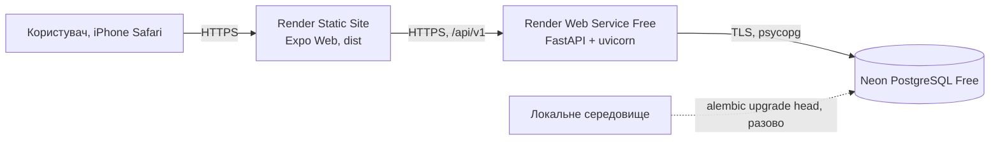

<!-- AI-GENERATED START -->
# Онлайн-розгортання Rehab: Render + Neon 

**Статус:** онлайн-середовище створено 29.10.2026 з гілки `codex/midterm-admin-deploy-sofiia`. 29.10.2026 Поліна застосувала початкову Alembic-міграцію `0001_initial` до онлайн-БД після перевірки на ізольованій гілці Neon. Реєстрація, календар, цілі, статистика та перерахунок перевірені через публічний API. Перезапуск API, блокування адміном та iPhone/Safari перевірено спільно 29.10.2026 (розділ 6). З 29.10.2026 Render розгортає гілку `develop` (автодеплой після кожного злиття). Проблеми з цілями й прямими посиланнями, виявлені на КТ-1/КТ-2, виправлено (розділ 7). Докази: [neon-migration-verification.md](../development/neon-migration-verification.md).

| Компонент | Адреса |
|---|---|
| Frontend | https://rehab-web-b9d5.onrender.com |
| API | https://rehab-api-0na0.onrender.com |
| БД | Neon, проєкт Rehab (`rough-lake-01450787`), гілка `production`, AWS Europe Central 1 (Frankfurt), Free |

Власниця акаунтів Render і Neon — Софія; Поліна має доступ до Neon-проєкту з роллю Editor.

## 1. Схема розгортання



| Компонент | Сервіс і тариф | Файл конфігурації |
|---|---|---|
| Frontend | Render Static Site | `render.yaml` (`rehab-web`), `frontend/app.json` (`web.output: "single"`) |
| Backend | Render Web Service, Free | `render.yaml` (`rehab-api`) |
| БД | Neon, Free | міграції `alembic/` |

Платні ресурси не вмикаємо.

## 2. Змінні середовища

Значення вводяться лише в панелі сервісів. У Git, PR, чат і `EXPO_PUBLIC_*` (крім публічної адреси API) їх не додаємо.

| Змінна | Де | Значення |
|---|---|---|
| `DATABASE_URL` | API | рядок з Neon (Connect), у якому початок `postgresql://` замінено на `postgresql+psycopg://`; `?sslmode=require` залишити. Інший префікс `backend/app/core/config.py` відхиляє |
| `JWT_SECRET` | API | випадковий, ≥ 32 символи (Render генерує через `generateValue`) |
| `CORS_ORIGINS` | API | точна HTTPS-адреса frontend, без `/` в кінці; кілька адрес через кому |
| `EXPO_PUBLIC_API_URL` | Frontend | HTTPS-адреса API **без** `/api/v1`; після зміни потрібна нова збірка |
| `PYTHON_VERSION` / `NODE_VERSION` | API / Frontend | `3.12.8` / `22.13.0` (задано в `render.yaml`) |

`APP_ENV` код зараз **не читає**, тому його не задаємо. Перевірено пошуком по `backend/`: використовуються лише `DATABASE_URL`, `TEST_DATABASE_URL` (тільки тести), `JWT_SECRET`, `CORS_ORIGINS`.

CORS: дозволені методи `GET, POST, PATCH, PUT, DELETE, OPTIONS`, заголовки `Authorization` і `Content-Type` (тести: `tests/test_health.py`).

## 3. Порядок розгортання

1. **Neon:** використовувати наявний проєкт Софії `rough-lake-01450787`, гілку `production`, БД `neondb`. Новий проєкт чи другу онлайн-БД не створювати. Доступ Поліни наданий через запрошення до організації.
2. **Міграції (одноразово, з підготовленого локального середовища)**, з кореня репозиторію, з адресою онлайн-БД у `DATABASE_URL`:
   ```bash
   python -m alembic upgrade head
   ```
   Для міграцій брати прямий рядок Neon (Connect → вимкнути Connection pooling, хост без `-pooler`); для API на Render — pooled.
   На Free немає окремого release-кроку, тому міграції запускаються вручну перед відповідною версією API. Тести й очищення даних виконуються лише в тестовій БД, онлайн-БД для pytest не використовується.
3. **Render API:** Blueprint із `render.yaml` або вручну; задати `DATABASE_URL`, `CORS_ORIGINS`.
4. **Render Static Site:** задати `EXPO_PUBLIC_API_URL` адресою API, запустити збірку.
5. Після появи адреси frontend повернутися до кроку 3 і вказати її в `CORS_ORIGINS`.
6. Створити адміна й демо-дані: `python -m scripts.seed_demo` з кореня репозиторію, з прямим (без `-pooler`) рядком Neon у `DATABASE_URL` (паролі лише зі змінних `SEED_*`, див. заголовок скрипта).

## 4. Обмеження Free

Render присипляє API після 15 хвилин без запитів, пробудження займає близько хвилини: систему відкриваємо завчасно перед перевіркою й захистом. Neon Free має ліміти ресурсів, використання потрібно контролювати.

## 5. Хто за що відповідає

Софія: Render, конфіг, CORS, `/health`, `/ready`, документація. Поліна: Neon і міграції. Анастасія: перевірка авторизації й клієнта на публічних адресах. Марія: підключення своїх модулів. Власниць акаунтів і спосіб командного доступу вписує команда тут: _не заповнено_.

## 6. Результати перевірок (заповнюється фактично)

| Перевірка | Результат | Дата |
|---|---|---|
| `GET /health` онлайн | `{"status":"ok"}` | 29.10.2026 |
| `GET /ready` онлайн | `{"status":"ok","database":"ok"}` — підключення до Neon є | 29.10.2026 |
| Frontend відкривається | екран входу відображається | 29.10.2026 |
| Міграція онлайн-БД | `0001_initial`; users/day_records/goals створено | 29.10.2026 |
| Реєстрація → вхід → `/me` | 2 синтетичні акаунти: 201 → 200 → 200 | 29.10.2026 |
| Календар зберігається після перезапуску | тестовий акаунт: записи й статистику зафіксовано до перезапуску; Render → rehab-api → Restart service; після повторного входу дані на місці | 29.10.2026 |
| Цілі, статистика, перерахунок | sober → ціль 1 день досягнута; PATCH relapse → серія 0, досягнення скасоване | 29.10.2026 |
| Ізоляція користувачів | чужі запис/ціль — 404; чужий календар порожній | 29.10.2026 |
| Вихід | 204; старий JWT — 401 | 29.10.2026 |
| Демоадмін і тестові акаунти | створено `python -m scripts.seed_demo` з прямим рядком Neon; основні акаунти учасниць не використовувались | 29.10.2026 |
| Блокування (admin) | звичайний користувач отримує 403 для admin API; адмін через вебадмінку заблокував окремий тестовий акаунт: активна сесія завершилась, повторний вхід заборонено | 29.10.2026 |
| iPhone Safari | iPhone 16 Pro Max, iOS 18.3.2: помилки 401 зникли, дані зберігаються після виходу й повторного входу; деталі — [iphone-kt1-2026-10-29.md](../validation/iphone-kt1-2026-10-29.md) | 29.10.2026 |
| Відображення цілей | на КТ-1 «Усі цілі виконано» показувалось помилково; виправлено фіксованими етапами 7/30 (PR №193, №196), див. розділ 7 | 29.10.2026 |
| Розгортання PR №192 (календар КТ2) | rehab-web на Render зібрано з develop; новий екран календаря відображається онлайн | 29.10.2026 |
| Деталі запису `/entry/<id>` з календаря | відкриваються (зрив, тригер, напій, коментар, кнопка редагування) | 29.10.2026 |
| Reload (F5) деталей запису в тій самій вкладці | деталі залишаються, 404 хостингу немає | 29.10.2026 |
| Пряме посилання `/entry/<id>` у новій вкладці | веде на вхід: сесія в sessionStorage окрема для вкладки (ТЗ 6.3) | 29.10.2026 |
| Після входу з прямого посилання | на КТ-2 відкривалась головна замість запису; виправлено в PR №200, №204, див. розділ 7 | 29.10.2026 |
| Підтвердження блокування/розблокування (PR №198) | онлайн після деплою: кнопка показує питання з email і кнопки «Так, …» / «Скасувати» | 29.10.2026 |
| Reload (F5) адмінки | список користувачів залишається, 404 хостингу немає | 29.10.2026 |
| Діаграма тригерів за 30 днів | натискання на сектор виділяє його й показує категорію, кількість і відсоток («Свято: 2 (18.2%)»); легенда з числами й відсотками | 29.10.2026 |

Android не входить до перевірок і не вказується як перевірений.

## 7. Приймання КТ-2

Код: `develop` `a4a3893` (злиття PR №204). Усі частини КТ-2 злиті: Анастасія — №200, №204; Поліна — №192; Марія — №193, №196; Софія — №198, №201, №203.

| Перевірка | Де | Результат | Дата |
|---|---|---|---|
| Backend-тести | локально, PostgreSQL 16 | 255 passed, покриття `backend.app` 92% | 30.10.2026 |
| Traceability | локально | `scripts/test_check_traceability.py` 4 passed; `check_traceability.py` PASS | 30.10.2026 |
| Black / Flake8 / Bandit / pip-audit | локально | без зауважень; деталі — `docs/code-quality/static-analysis.md` | 30.10.2026 |
| OpenAPI | `scripts/export_openapi.py` | збігається з маршрутами | 30.10.2026 |
| Frontend | локально | lint 0 помилок, `tsc` OK, `test:api` 46/46, `expo export --platform web` OK | 30.10.2026 |
| Сценарій КТ-2 через API (ТЗ 11.5) | локально, чиста БД + `seed_demo` | реєстрація → етапи 7/30 не виконані; дублікат 409; майбутня дата 422; деталі; редагування sober → relapse перераховує статистику й етапи; чужий запис 404; демоакаунт — етапи 7/30 виконані за історією; адмін: список без хешів, діаграма, блокування → старий JWT і вхід 403 `ACCOUNT_BLOCKED`; самоблокування адміна 403 | 30.10.2026 |
| Онлайн, iPhone (після №204) | https://rehab-web-b9d5.onrender.com | перевірка Поліни: онлайн-сценарії працюють | 29.10.2026 |
| Онлайн, ПК: адмінка, діаграма, F5 | https://rehab-web-b9d5.onrender.com | див. розділ 6 | 29.10.2026 |

**Відоме обмеження:** з 00:00 до 03:00 за Києвом діаграма тригерів бере дату сервера (UTC), тому період зсунутий на день (`backend/app/routers/admin.py`).

**Фінальне подання:** онлайн-версія має відповідати `main`. Після погодженого злиття `develop` → `main` гілку Render для `rehab-api` і `rehab-web` змінюють на `main`, а тут фіксують commit розгортання й `/health`, `/ready`.
<!-- AI-GENERATED END -->
