# Дизайн мобільного застосунку «Рехаб» (попередній макет)

> **Статус: попередній макет.** Це концепт майбутнього мобільного застосунку, а не готовий інтерфейс. Екрани намальовано у Figma, щоб показати, як можуть виглядати основні сценарії. 

**Макет у Figma:** https://www.figma.com/design/ZccZ7FJ7wuwYdRAes2xG9y/Untitled?node-id=0-1&t=gxso9Bz0mgRrA5RO-1

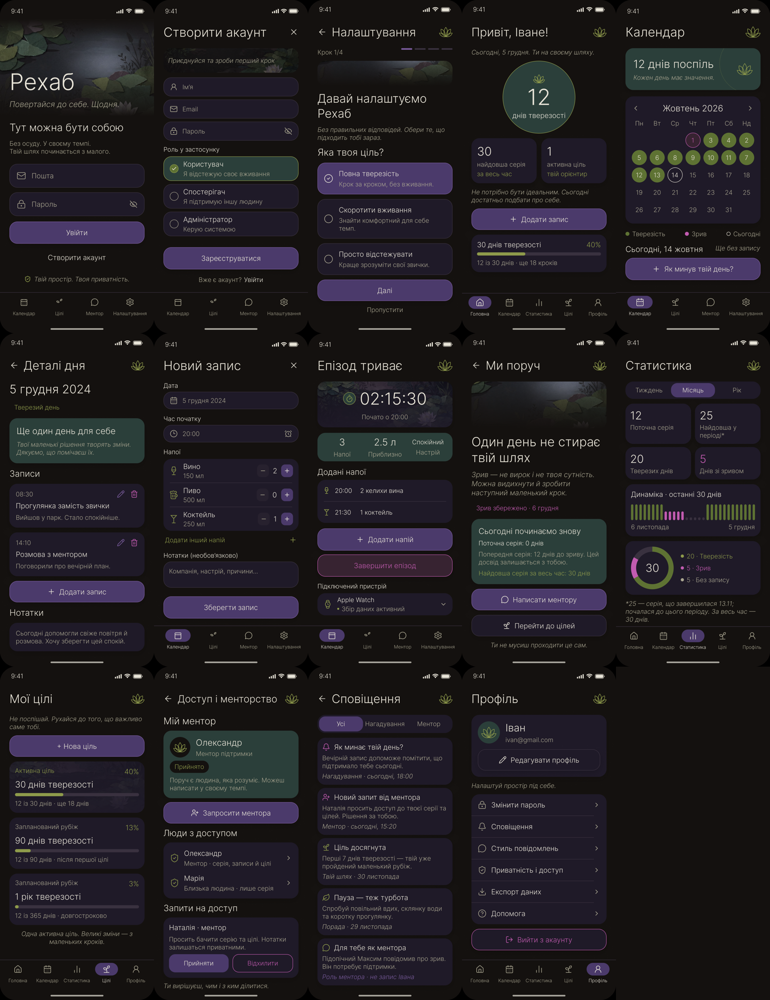

## Екрани

### 1. Вхід

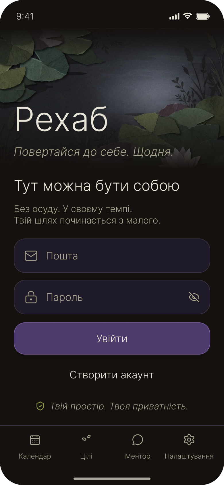

### 2. Створити акаунт

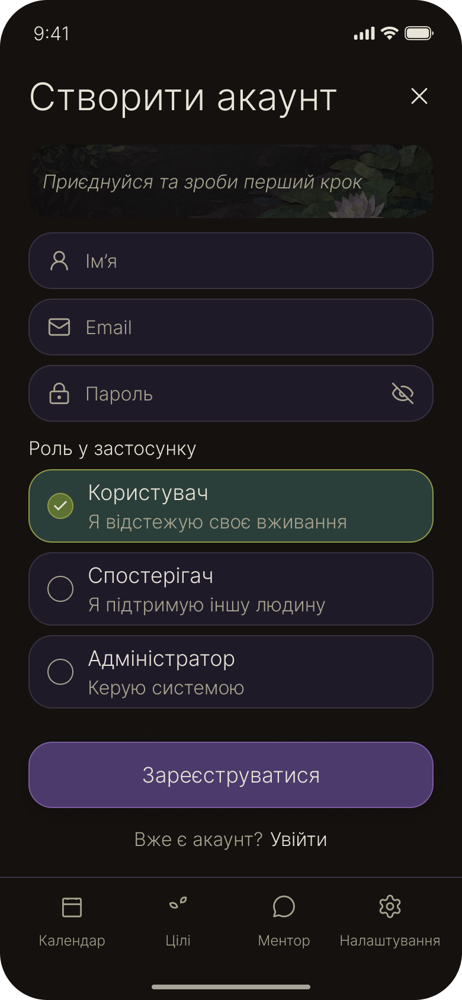

### 3. Початкове налаштування

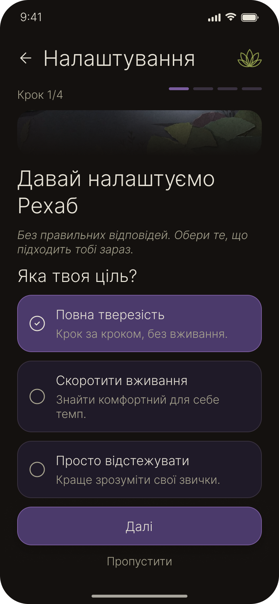

### 4. Головна

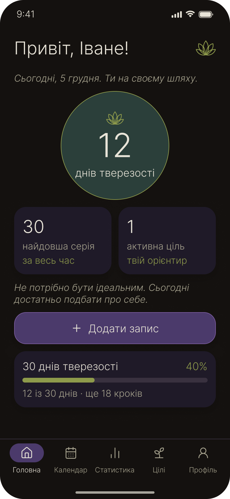

### 5. Календар

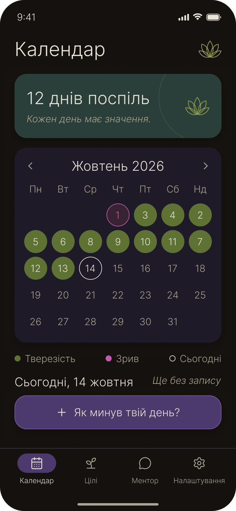

### 6. Деталі дня

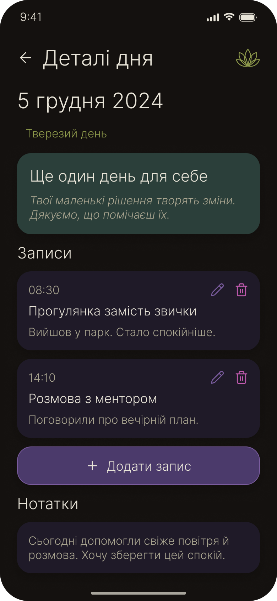

### 7. Новий запис

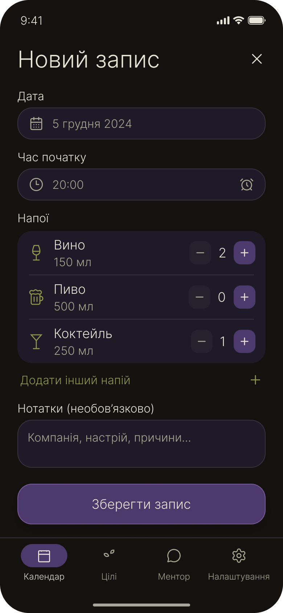

### 8. Активний епізод

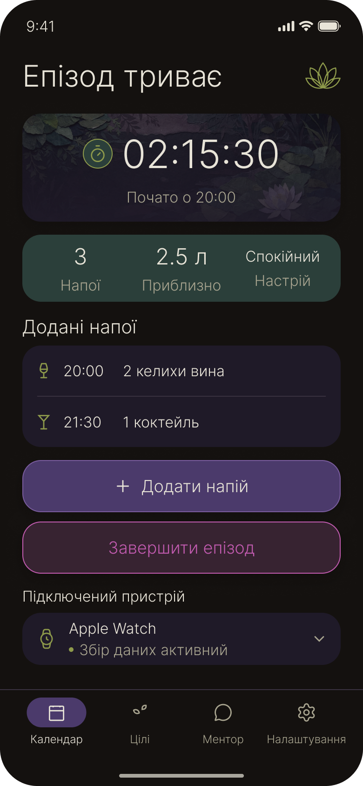

### 9. Підтримка після зриву

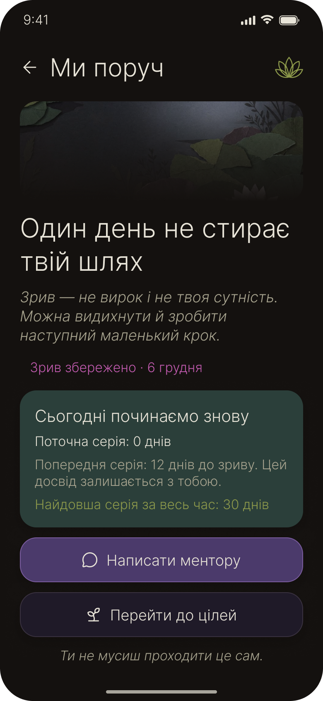

### 10. Статистика

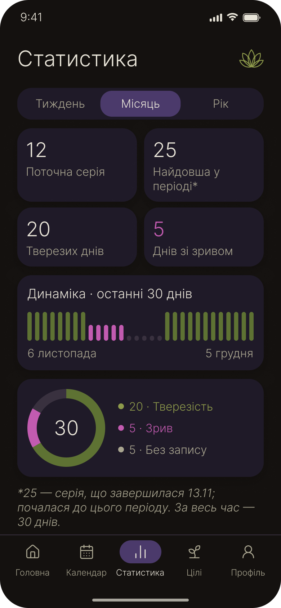

### 11. Цілі

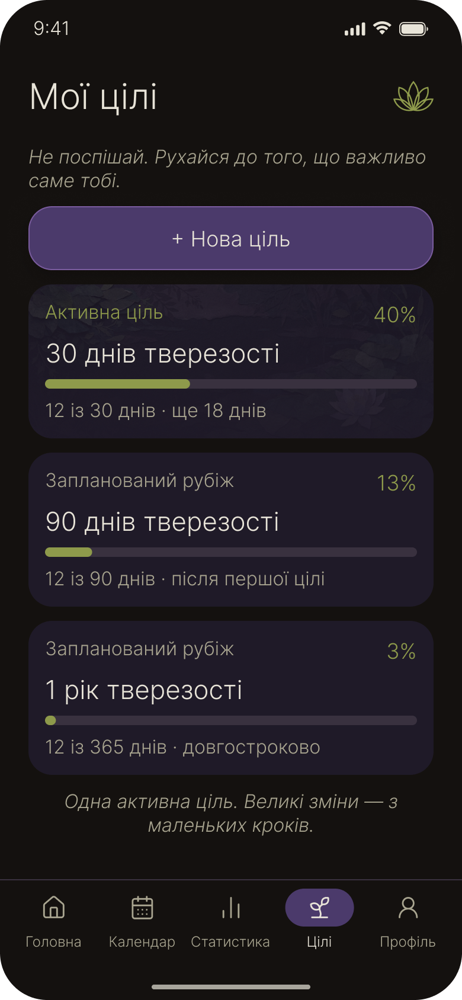

### 12. Доступ і менторство

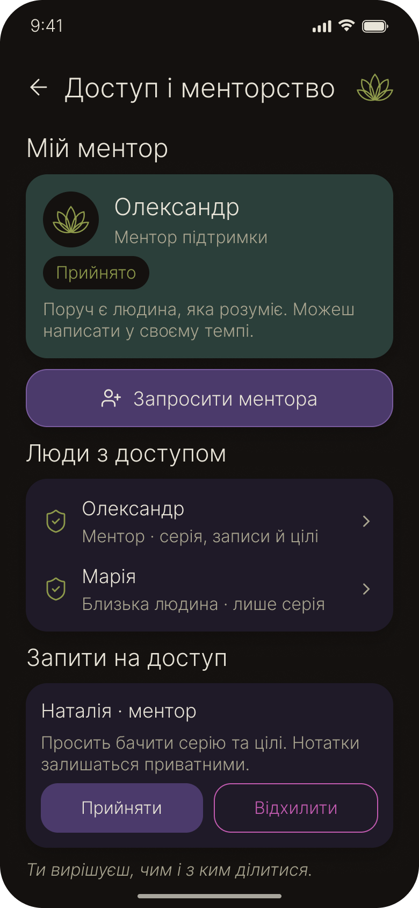

### 13. Сповіщення

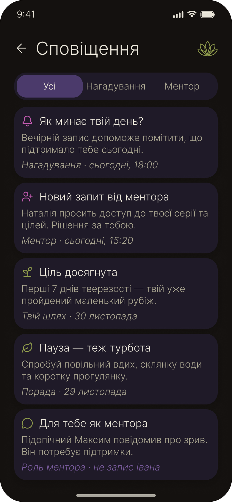

### 14. Профіль і налаштування

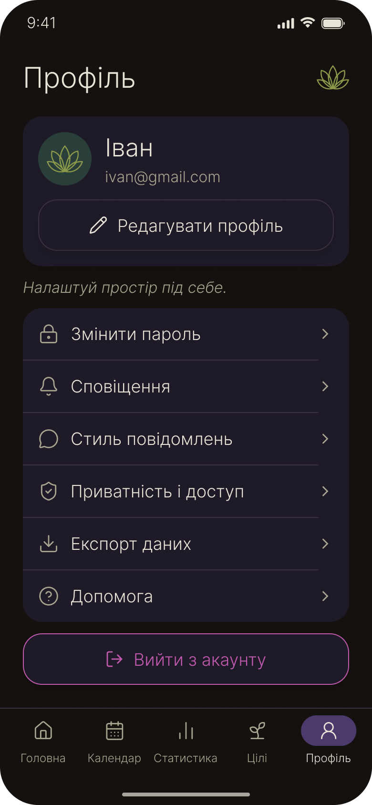

## ТЗ-3: етапи та повідомлення (підготовка до КТ-А)

У гілці Марії реалізовано п'ять фіксованих етапів: 7, 30, 90, 180 і 365 днів. Підписи 90/180/365 пояснюють тривалість, але розрахунок ведеться в днях. Поточний етап — найменший невиконаний; історична відзнака залежить від найдовшої серії. Виправлення минулого запису може перерахувати рекорд. Власні цілі не створюються.

Майбутні екрани /messages та /messages/[notification_id] відкриватимуться з кнопки праворуч угорі головної з кількістю непрочитаних. Вони ще не підключені до робочої навігації: потрібні спільна ORM-основа, notifications API та ProfileProvider. Список: нові спочатку, 30 за порцію, підвантаження, loading/empty/error/retry; відкриття позначає прочитаним. У detail показуються серверні title/body та незмінений текст підтримки. Дії підтримки, перегляду підопічного й скарги дозволяються лише за актуальним API, історія після завершення лишається. Повний чат не додається.

Каталоги backend/app/services/message_catalog.json та frontend/src/messages/catalog-data.json мають однакові ключі й чотири стилі formal/humorous/zen/strict. messageText(key, style, context) повертає title/body як звичайний текст. Стиль із живого ProfileProvider підключається на КТ-Б; production-заглушки профілю не створені. Ключі home.motivation, goals.motivation, calendar.empty, statistics.empty, support.empty, daily_reminder, relapse, relapse.corrected, support_comment. Для relapse потрібні nickname/date, для relapse.corrected — date. Авторський текст підтримки в каталог не передається.
