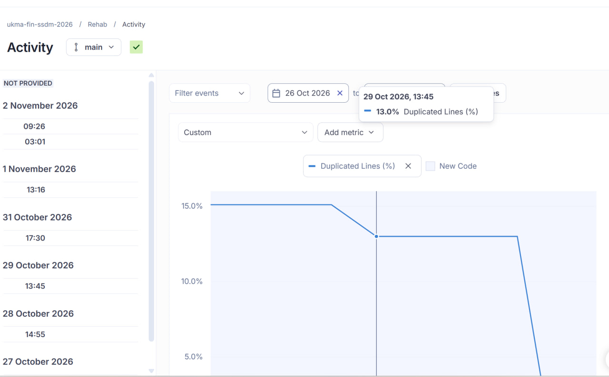
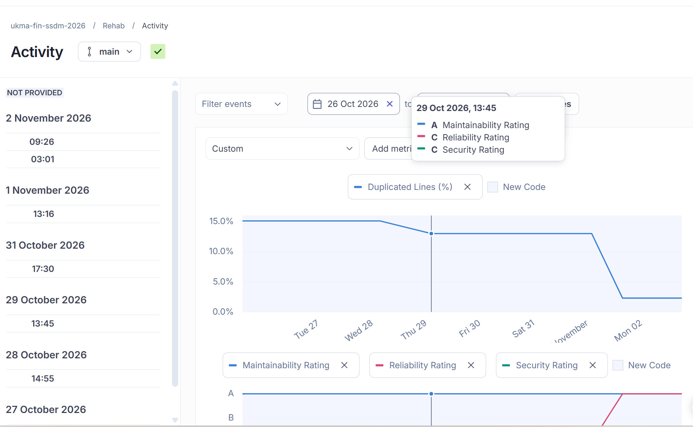
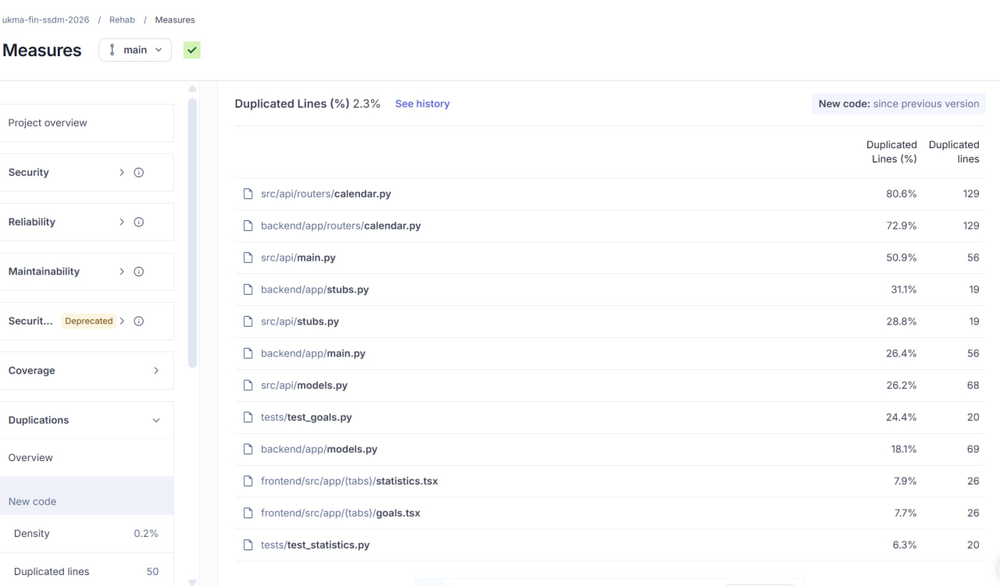
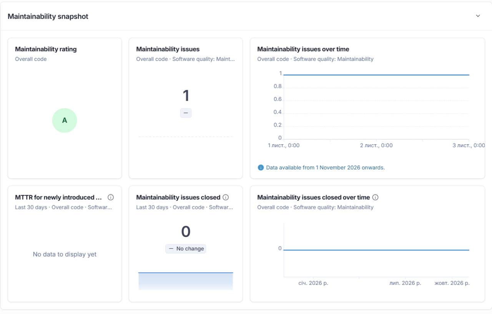
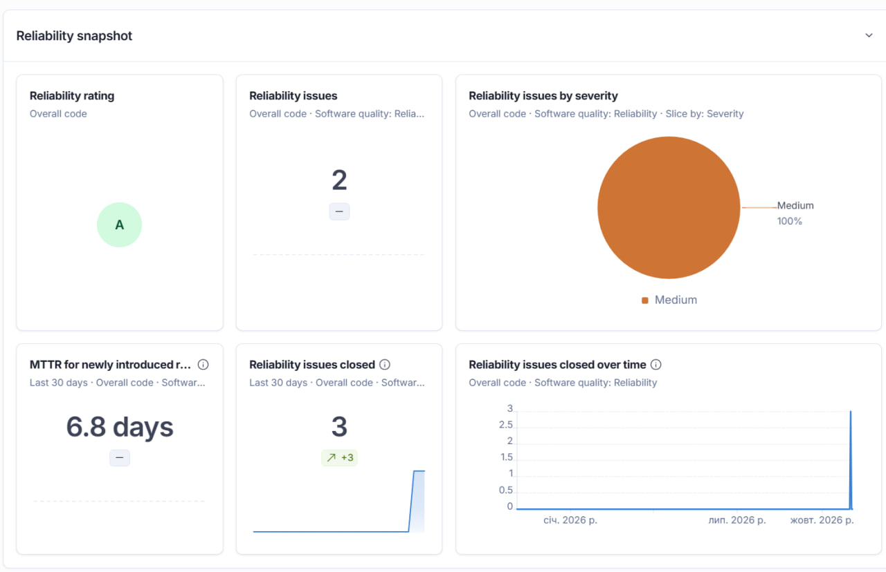
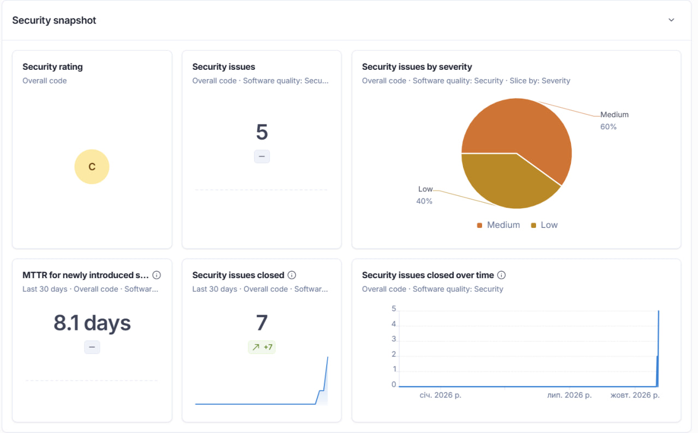

# Аналіз SonarQube та рефакторинг — Лабораторна робота №8

**Проєкт:** Rehab  
**Дата звіту:** 04.11.2026 (вимірювання 29.10 і 03.11)  
**Інструмент:** SonarQube Cloud  
**Порівняння:** історичний аналіз `main` 29.10.2026, 13:45, і стан `main` 03.11.2026; історичний код збережено у `pre-refactor`  
**Pull Request:** [Рефакторинг Rehab #206](https://github.com/ukma-fin-ssdm-2026/Rehab/pull/206)

## 1. Аналіз якості коду (етап 1)

Переглянуто [панель Rehab у SonarQube Cloud](https://sonarcloud.io/project/overview?id=ukma-fin-ssdm-2026_Rehab) та історію показників на сторінці Activity. Початковий стан коду збережено в [гілці `pre-refactor`](https://github.com/ukma-fin-ssdm-2026/Rehab/tree/pre-refactor), але метрики «до» отримані з **реального історичного аналізу `main` від 29.10.2026, 13:45**, а не з повторного сканування цієї гілки.

Для лабораторної обрано три метрики з п'яти. **Security Rating записано окремо**, як вимагає завдання. Вихідні значення записані у звіті 30.10.2026 і підтверджені історією SonarQube за 29.10.2026. Показники «після» відображають результат **командних змін у `main`**, зокрема синхронізації 352 комітів; це не ефект лише особистого рефакторингу.

| Показник | До рефакторингу | Після рефакторингу |
|---|---|---|
| Duplicated Lines (%) | 13,0% | 2,3% |
| Maintainability Rating | A | A |
| Reliability Rating | C | A |
| Security Rating (обов'язковий) | C | C |

### Скриншоти SonarQube: «до» і «після»

Усі зображення відображають проєкт **Rehab**. Для стану «до» використано історію **Activity → main**, а для стану «після» — **Measures / Overall Code** та snapshots. Скриншоти «до» було відкрито 03.11.2026, проте курсор на графіках указує на **історичний аналіз 29.10.2026 о 13:45**. Це не скриншоти, зроблені 29 жовтня, і не аналіз окремої гілки `pre-refactor`.

**До рефакторингу — 29.10.2026, 13:45:**

**Після рефакторингу — 03.11.2026, main / Overall Code:**

**Висновок за знімками:** загальна частка дублікатів зменшилася з **13,0% до 2,3%** (на **10,7 відсоткових пункта**), Reliability Rating підвищився з **C до A**, Maintainability Rating залишився **A**, а Security Rating — **C**. На поточному знімку залишаються 5 відкритих Security Issues. У [PR №236](https://github.com/ukma-fin-ssdm-2026/Rehab/pull/236) зафіксовано версії Python-залежностей для CI та API-документації; наведені показники SonarQube відображають стан на дату вимірювання.

**Початкові числові записи (30.10.2026; історія Activity підтверджує рейтинги та дублювання за 29.10):** Quality Gate Passed; 12 Security Issues (10 Medium, 2 Low), 4 Reliability Issues, 0 проблем супроводжуваності. Coverage у SonarQube не відображалося.

**Повторний перегляд Overall Code (03.11.2026):** Security Rating C, 5 відкритих Security Issues (3 Medium, 2 Low), 2 відкриті Reliability Issues. Maintainability і Reliability мають рейтинг A за переглядом панелі. За останні 30 днів SonarQube відображає 7 закритих Security Issues. Duplicated Lines (%) після змін становить 2,3% за Overall Code.

Найвищі локальні показники дублювання залишаються у `src/api/routers/calendar.py` (80,6%) та `backend/app/routers/calendar.py` (72,9%).

Вихідна оцінка 30.10 належить старому стану коду до синхронізації PR №206 з `main` на 352 коміти. Тому різницю в кількості issues або рейтингах не можна повністю приписувати одному рефакторингу. Для аналізу актуального `main` використовуємо коміт [`29399f8`](https://github.com/ukma-fin-ssdm-2026/Rehab/commit/29399f8a1ab11c6fb48757901c9b3f821c732461).

### Причини Security Rating C

| Файл | Відкриті issues | Серйозність | Рішення |
|---|---:|---|---|
| `.github/workflows/ci.yml`, рядки 43–44 | 2 | Medium | Версії пакетів зафіксовано в [PR №236](https://github.com/ukma-fin-ssdm-2026/Rehab/pull/236) |
| `.github/workflows/docs.yml`, рядок 32 | 1 | Medium | Єдиний файл закріплених версій додано в [PR №236](https://github.com/ukma-fin-ssdm-2026/Rehab/pull/236) |
| `docs/api/index.html`, рядки 6 і 10 | 2 | Low | Ризик підміни зовнішніх CSS/JS; запропонований захист — фіксація версії Swagger UI та атрибути SRI |

Попередні зауваження до відсутнього `--only-binary=:all:` уже мають статус Fixed. Вони відрізняються від відкритих зауважень щодо незакріплених версій. Успішний Quality Gate сам по собі не підтверджує Security Rating A.

**Зв'язок із попередніми лабораторними:** у [STRIDE-моделі Lab 3](../architecture/threat-model.md) категорія Tampering стосується ризику несанкціонованої зміни даних. Неконтрольовані пакети та зовнішні ресурси створюють споріднений ризик підміни коду в ланцюгу постачання, не тотожний описаному сценарію зміни календарних даних. [Bandit та pip-audit із Lab 5](../code-quality/static-analysis.md) перевіряють Python-код і відомі вразливості залежностей, але не замінюють фіксацію версій або перевірку цілісності CDN-ресурсів.

## 2. Рефакторинг (етап 2)

### Таблиця рефакторингів: запах → техніка → інваріант → тест

У таблиці згруповано зміни за трьома напрямами: ініціалізація та накопичення даних, дублювання логіки, неочевидні числові межі й умови. Для кожного рефакторингу наведено окремі інваріанти, тести та статус. Джерела — опубліковані коміти та PR; неперевірені ідентифікатори SonarQube issues не приписуються цим змінам.

| Відповідальна / місце | Запах | Техніка з каталогу та зміна структури | Що лишається незмінним | Точний доказ і статус |
|---|---|---|---|---|
| Поліна — `backend/app/services/drink_summary.py::volume_by_type_ml` | Неявна ініціалізація накопичувача через повторюваний `dict.get(key, 0)` усередині циклу; типи полів раніше описувалися через `Any` | **Substitute Algorithm**: накопичення через `defaultdict(int)`, на межі повертається `dict(totals)`. Супровідне уточнення анотацій через `Drink(TypedDict)` не додає runtime-валідацію | Сума для кожного типу; нульові й порожні дані; довільні назви типів; порядок першої появи ключів; один прохід iterable; звичайний `dict` у результаті; вхідні дані не змінюються | `tests/test_drink_summary.py`: `test_volume_is_grouped_by_drink_type`, `test_grouping_preserves_empty_zero_and_arbitrary_types`, `test_grouping_consumes_a_single_pass_iterable`, `test_summary_does_not_modify_input`, `test_total_accepts_a_single_pass_iterable`. Уже в `main`: [`2007fe1`](https://github.com/ukma-fin-ssdm-2026/Rehab/commit/2007fe1d1c36ee5617e4c7a57a1f1f684ba0a506), [`8b2eff4`](https://github.com/ukma-fin-ssdm-2026/Rehab/commit/8b2eff41dbef6bef19c82652d167bcee1599f44a). Той самий набір на реалізації до `8b2eff4` і після — **10/10 тестів в обох випадках**. Додаткові тести підготовлені в PR №240 |
| Анастасія — історичні зміни `backend/app/services/statistics.py::get_days_remaining` | Неочевидні числа 7/30, назви проміжних значень і складений вибір наступної цілі | **Replace Magic Number with Constant / Rename Variable**, потім **Substitute Algorithm**: іменовані значення та вибір першої наступної цілі циклом | Для історичних двох цілей — результат підрахунку залишку днів і відхилення від'ємного введення | Коміти [`53d5295`](https://github.com/ukma-fin-ssdm-2026/Rehab/commit/53d5295272b2808c71eb5f0e2120a6c5cb1d731c) і [`537e322`](https://github.com/ukma-fin-ssdm-2026/Rehab/commit/537e322c2723a6addf934982e4550da0f007902a), `tests/test_goal_remaining.py`. Це історичні рефакторинги; зараз `main` і поточні тести використовують п'ять етапів. Парний прогін на історичній реалізації тут не зафіксований |
| Анастасія — `backend/app/stubs.py::reset` | Змішані обов'язки скидання сховища та побудови початкових записів | **Extract Method**: створення двох записів винесено до `_initial_entries(now, today)`; `reset()` очищає ті самі словники, відновлює лічильник і додає записи | Початкові записи та їхні ID, статуси, дати й UTC-час, ідентичність спільних словників, перезапуск лічильника | `tests/test_stubs_characterization.py`: `test_reset_recreates_original_seed_data`, `test_reset_preserves_shared_dictionaries_and_restarts_counter`. [PR №238](https://github.com/ukma-fin-ssdm-2026/Rehab/pull/238): тести в `37b059e`, рефакторинг у `cda574d`; два окремі коміти й успішні CI-перевірки |
| Марія — `backend/app/services/progress.py::format_progress_days` | Дублювання складання рядка та залежність від приватної `_day_word()` | **Reuse Method**: використано публічну `format_days(days)` замість повторного форматування рядка; валідацію збережено у `format_progress_days()` | Сигнатура, точний текст, TypeError для `bool` і нецілих значень, ValueError для від'ємних цілих | `tests/test_progress.py`: `test_format_progress_days_boundaries`, `test_format_progress_days_rejects_string`, `test_format_progress_days_rejects_boolean`, `test_format_progress_days_rejects_non_integer_values`, `test_format_progress_days_rejects_negative`. [PR №241](https://github.com/ukma-fin-ssdm-2026/Rehab/pull/241), коміт `3721769`; **злито в `main`**. Результати регресії — у розділі 3.1 авторки |
| Софія — `backend/app/services/formatting.py::_day_word` | Неочевидне призначення числових меж та складеної умови відмінювання | **Replace Magic Number with Constant + Decompose Conditional**: іменовані межі `TEENS_FIRST/TEENS_LAST`, `FEW_FIRST/FEW_LAST`, `ONE`; перевірка 11–14 винесена в `_is_teen()` | Результат `format_days()` і `_day_word()`, включно з 0, складеними та від'ємними числами; жодних нових обмежень введення | `tests/test_formatting.py::test_format_days_characterization` — 22 додаткові випадки у [гілці `lab08-release-sofiia`](https://github.com/ukma-fin-ssdm-2026/Rehab/tree/f14878180c6cc533ef1d535a2e6a01efd9a54ff3). Тести — `e957663`, наступний коміт рефакторингу — `a3d786c`. зміни злиті в `main` через PR №242 |

У поточній системі збережено п'ять етапів `7/30/90/180/365`; стару реалізацію лише для `7/30` повторно не переносимо.

**Матеріали аналітика:** результати SonarQube й скриншоти наведено у розділі 1.

### 2.1. Усунення повторення форматування днів

**Запах коду:** повторення умов для вибору слова «день», «дні», «днів».  
**Техніка:** використання спільного методу (*Reuse Method*).  
**Файл:** `backend/app/services/progress.py`.

**До:** `format_progress_days()` самостійно перевіряла закінчення числа. Аналогічна логіка вже була у `backend/app/services/formatting.py`.

**Після:** використано наявну `_day_word()`, тому правила більше не дублюються.

**Що не змінилося:** формат результату (наприклад, «1 день», «3 дні», «5 днів») і перевірка неправильних вхідних даних.  
**Тести:** `tests/test_progress.py`, `tests/test_formatting.py`.

### 2.1.1. Власний рефакторинг `maryxseee` — Reuse Method

Після PR #206 `progress.py` імпортував приватну `_day_word()` і повторював
складання рядка. За власною частиною Lab08 виклик замінено на публічну
`format_days(days)`. Валідація залишилася в `format_progress_days()`:
TypeError для bool і нецілих значень, ValueError для від'ємних цілих.
Формат результату й обидві публічні функції збережено.

Перед зміною до `tests/test_progress.py` додано 11 граничних випадків:
12–14, 112–114, 1001, False, 3.0, -1.0 і None. Прибрано зайвий повторний
виклик у тесті рядкового аргументу. Ті самі 72 модульні тести пройшли
до й після зміни. Бонус за характеризаційні тести раніше непокритого
модуля не заявляється: модуль уже мав тести до Lab08.

### 2.2. Винесення цілей у константу

**Запах коду:** числа 7 та 30 повторювалися в обчисленнях прогресу.  
**Техніка:** *Replace Magic Number with Constant*.  
**Файл:** `backend/app/services/statistics.py`.

**До:** `get_goal_progress()` і `get_days_remaining()` містили однакові значення цілей 7 і 30 окремо.

**Після синхронізації:** в актуальному `main` використовується `FIXED_GOAL_DAYS = (7, 30, 90, 180, 365)`, тому стару реалізацію не переносили.

**Що не змінилося:** поведінка актуальної реалізації п'яти етапів.  
**Тести:** `tests/test_statistics.py`, `tests/test_goal_remaining.py`.

### 2.3. Магічні числа у форматуванні днів (Софія)

**Запах коду:** магічні числа 11, 14, 2, 4, 1 в умовах `_day_word()` без пояснення, що вони означають.  
**Техніка:** *Replace Magic Number with Constant* і *Decompose Conditional*.  
**Файл:** `backend/app/services/formatting.py`.

**До:** `if 11 <= n % 100 <= 14`, `if last == 1`, `if 2 <= last <= 4`.

**Після:** константи `TEENS_FIRST`, `TEENS_LAST`, `FEW_FIRST`, `FEW_LAST`, `ONE` і функція `_is_teen()` для випадку «11–14».

**Що не змінилося:** назви й параметри `_day_word()` і `format_days()` (`format_days()` використовує `progress.py`, п. 2.1.1) та результат для будь-якого числа.  
**Що змінилося в структурі:** умови читаються за назвами правил, а не за числами.  
**Тести:** `tests/test_formatting.py`: 22 характеризаційні тести (зокрема 0, 11–14, 111–115, 1011, від'ємні числа) закомічено **до** рефакторингу окремим комітом; ті самі тести зелені до і після.

### 2.4. Безпека

У GitHub Actions додала `--only-binary=:all:` для безпечнішого встановлення Python-пакетів. Потім виправила помилки YAML.

### 2.5. Використання ШІ

ChatGPT допоміг з оформленням документації та підказав варіанти рефакторингу.

Рефакторинг 2.3 виконано з ШІ-агентом Claude Code. Завдання агенту: запах (магічні числа), техніка (Replace Magic Number with Constant, Decompose Conditional), незмінне — сигнатури та результат для будь-якого n. Агент згенерував характеризаційні тести й нову версію `_day_word()`.

Верифікація:
- перегляд змін рядок за рядком; запропонований варіант `n % 100 in range(11, 15)` відхилено, бо він змінює результат для дробових чисел (12.5: «днів» → «дні»), залишено ті самі порівняння з константами;
- порівняння старої й нової функції на 20 009 значеннях (від −10 000 до 10 000 і дробові, зокрема 12.5) — 0 відмінностей;
- регресійні тести до і після (розділ 3).

#### Командне застосування ШІ (Поліна)

**Поліна — Codex / ChatGPT:** підготувала за допомогою асистента таблицю рефакторингів, додаткові тести власної зміни та нотатку про використання ШІ.

**Завдання Поліни агенту:** перевірити рефакторинг групування напоїв (`dict.get` → `defaultdict(int)`, Substitute Algorithm), зберігши суми, порядок ключів, одноразові iterable, звичайний тип `dict` і незмінність входу. Підготовлено вісім додаткових сценаріїв у `tests/test_drink_summary.py` — разом 10 із двома наявними. Керівником рефакторингу переглянуто diff та перевірено повернення `dict(totals)`; однакові тести на історичній і поточній реалізаціях пройшли, як зазначено в таблиці.

**Марія — Codex:** у [PR №241](https://github.com/ukma-fin-ssdm-2026/Rehab/pull/241) опубліковано використання агентом `format_days()` зі збереженням валідації та додані граничні тести. Коментарі авторки в `progress.py` і `test_progress.py` фіксують завдання агенту й ручну перевірку результатів та типів винятків. Керівником рефакторингу перевірено відповідність опублікованого diff інваріантам таблиці. Регресійні результати залишені в розділі 3.1 Марії без дублювання.

**Софія — Claude Code:** у [власному описі Софії](https://github.com/ukma-fin-ssdm-2026/Rehab/blob/f14878180c6cc533ef1d535a2e6a01efd9a54ff3/docs/refactoring/sonarcloud-report.md) зафіксовано завдання щодо магічних чисел у `formatting.py`, техніки Replace Magic Number with Constant / Decompose Conditional та збереження сигнатур і результату. Агент згенерував характеризаційні тести й нову `_day_word()`. За опублікованим описом авторки, патч переглянуто рядок за рядком, варіант із `range(11, 15)` відхилено через зміну результату для `12.5`, порівняння на 20 009 значеннях не виявило відмінностей. Керівником рефакторингу перевірено збереження порівнянь числових меж у diff та порядок комітів тестів і рефакторингу. Зміни інтегровано у `main` через PR №242.

## 3. Перевірка результату (етап 3)

Регресія для рефакторингу 2.3 (04.11.2026, локально, PostgreSQL 16, після злиття #241): `main` до зміни — 474 passed; після — 496 passed (+22 характеризаційні тести), падінь немає. Black і Flake8 для `backend` — без зауважень. Frontend: TypeScript, lint, тести й web export — без помилок.

У [PR №206](https://github.com/ukma-fin-ssdm-2026/Rehab/pull/206) успішно пройшли Backend, Frontend, Code Quality, Dependency Audit, Traceability та SonarQube. Регресійні результати після командних змін наведено нижче.

### 3.1. Регресійна перевірка `maryxseee`, 04.11.2026

Основа зміни — актуальний main `29399f8a1ab11c6fb48757901c9b3f821c732461`.
Для повного прогону використано Python 3.12.10, залежності requirements.txt
в окремому .venv та ізольовану PostgreSQL 16. Робочі дані не використовувалися.

| Перевірка | Результат |
|---|---|
| Модульні тести до рефакторингу | 72 passed in 2.91s |
| Ті самі тести після рефакторингу | 72 passed in 2.94s |
| Повний серверний набір після рефакторингу | 474 passed, 2 warnings in 417.04s |
| Повторний повний прогін з порогом 90% | 474 passed, 1 warning in 264.08s |
| Покриття backend.app | 94% |
| Покриття progress.py та formatting.py | 100% |

Покриття 94% відповідає погодженій цілі не нижче 90% із
[критеріїв виходу тест-плану](../validation/test-plan.md#критерії-виходу).
Два попередження першого повного прогону стосуються Starlette TestClient
і прав запису кешу pytest. Повний набір до зміни окремо не завершувався;
парне порівняння до/після стосується 72 модульних тестів. Frontend не змінено
й окремо не перевірено. Ручну перевірку maryxseee підтверджено 04.11.2026.

Повторний повний прогін виконувався з `--cov-fail-under=90`; точне
покриття становить **93,62%**, поріг пройдено. Кеш pytest вимкнено
через `-p no:cacheprovider`, тому залишилося одне попередження Starlette.
Перша спроба повторного прогону отримала помилки підготовки fixtures,
оскільки PostgreSQL ще запускалася, і була зупинена. Після `pg_isready`
пройшли 19 тестів адмінської частини, потім усі 474 тести повного набору.
Black перевірив 66 Python-файлів; Flake8 не виявив помилок.

Результати відображають перевірений стан коду на дату прогону; інші рефакторинги перевірялися відповідними PR.

Аналіз SonarQube та Security Rating документовано в розділі 1, командну роботу з ШІ — у розділі 2.

## 4. Підготовка релізу та висновок

Оновила версію до `1.0.1` і додала `CHANGELOG.md`.

Менеджерка релізу Софія узгодила версію `1.0.1` у `pyproject.toml`, `backend/app/main.py`, `frontend/package.json` та `CHANGELOG.md` (PR №242). Git-тег [`v1.0.1`](https://github.com/ukma-fin-ssdm-2026/Rehab/releases/tag/v1.0.1) зафіксував реліз. Показники SonarQube за 03.11.2026 та їхні скриншоти наведено в розділі 1.

## Бонуси

**Характеризаційні тести перед рефакторингом.** Для `format_days()` спершу додано 22 тести поточної поведінки, включно з незвичною для від'ємних чисел (`-1` → «-1 днів»). Коміт із тестами (`test: характеризаційні тести format_days перед рефакторингом`) раніший за коміт рефакторингу (`[REFACTOR] formatting: ...`); ті самі тести зелені до і після.

### Бонус №1 — обов’язковий Quality Gate (`maryxseee`)

Я перевірила блокування на [PR №243](https://github.com/ukma-fin-ssdm-2026/Rehab/pull/243).
Для контрольованого червоного результату додала тимчасовий модуль
`backend/app/quality_gate_probe.py` з двома однаковими функціями.
Модуль не підключався до застосунку.

| Стан | Коміт | Дублювання нового коду | Поріг | SonarCloud Code Analysis |
|---|---|---:|---:|---|
| До виправлення | [d72f1e5](https://github.com/ukma-fin-ssdm-2026/Rehab/commit/d72f1e59ca504809b3c5ed48a71898651f703f2c) | 80,0% | ≤ 3% | [Failure — червона перевірка](https://github.com/ukma-fin-ssdm-2026/Rehab/runs/126767356859) |
| Після виправлення | [4a535c4](https://github.com/ukma-fin-ssdm-2026/Rehab/commit/4a535c43a665c9363ac9c3e01c88f92d111a777f) | 0,0% | ≤ 3% | [Success — зелена перевірка](https://github.com/ukma-fin-ssdm-2026/Rehab/runs/126768918900) |

У [чинних правилах main](https://api.github.com/repos/ukma-fin-ssdm-2026/Rehab/rules/branches/main)
перевірка `SonarCloud Code Analysis` від SonarQube Cloud (integration ID 12526)
є обов’язковою. Її червоний результат не задовольняв вимогу до злиття;
інші умови самого Quality Gate проходили. Правила захисту не змінювалися.

Я прибрала лише дубльовану функцію окремим комітом `4a535c4`.
SonarQube повернув Quality Gate `OK`, дублювання — 0,0%;
умови аналізу не ігнорувалися (`ignoredConditions=false`).
Потім окремими комітами видалила решту тимчасової функції й файл прикладу.
Фінальний diff PR містить лише цей розділ звіту, без демонстраційного коду.

Перевіряла саме `SonarCloud Code Analysis`: інший статус із назвою
`SonarCloud` не використовується як доказ проходження Quality Gate.
Зелене проходження цього gate не підміняє інші обов’язкові перевірки CI
та схвалення колеги. Самостійне злиття агентом не виконувалося.

Ручний перегляд результатів демонстрації `maryxseee` підтверджено 04.11.2026.

### Бонус №2 — характеризаційні тести перед рефакторингом

Для модуля `backend/app/stubs.py`, який до Lab 08 не мав окремих модульних тестів, створено [PR №238](https://github.com/ukma-fin-ssdm-2026/Rehab/pull/238) з **двома послідовними комітами**:

1. **До рефакторингу:** [`37b059e`](https://github.com/ukma-fin-ssdm-2026/Rehab/commit/37b059e5a06203464f4846e2734a08359e07b500) — додано `tests/test_stubs_characterization.py`. Тести фіксують два початкові записи, статуси, дати, часову різницю між створенням записів, UTC, стабільність об'єктів словників та перезапуск лічильника ID. [CI до рефакторингу](https://github.com/ukma-fin-ssdm-2026/Rehab/actions/runs/41650201764).
2. **Після рефакторингу:** [`cda574d`](https://github.com/ukma-fin-ssdm-2026/Rehab/commit/cda574d834768136838ee28ccc76b3a3fd5f5d07) — технікою *Extract Method* винесено створення початкових записів із `reset()` до `_initial_entries()`. Ті самі характеризаційні тести перевіряють незмінну поведінку. [CI після рефакторингу](https://github.com/ukma-fin-ssdm-2026/Rehab/actions/runs/41650402045).

**Результати:** характеризаційні тести успішно пройшли CI як до рефакторингу, так і після нього. Історія двох послідовних комітів підтверджує порядок *Tests Before Refactoring*.

### Бонус №3 — автоматизований реліз (налаштування)

У [PR №239](https://github.com/ukma-fin-ssdm-2026/Rehab/pull/239) налаштовано Release Please у GitHub Actions. Conventional Commit `refactor:` включений до журналу змін як **Refactoring**; тип версії визначається правилами SemVer та налаштуванням релізного інструмента. Інструмент має автоматично оновлювати версію у `pyproject.toml`, `version.txt`, `.release-please-manifest.json`, запис у `CHANGELOG.md`, а після злиття релізного PR створювати тег `vX.Y.Z` і GitHub Release. [Процедура перевірки](https://github.com/ukma-fin-ssdm-2026/Rehab/blob/lab08-bonus-automated-release-20261103/docs/refactoring/automated-release.md).

**Результати:** [PR №239](https://github.com/ukma-fin-ssdm-2026/Rehab/pull/239) пройшов CI, включно з Backend, Frontend, SonarQube та перевірками конфігурації. Конфігурацію Release Please додано окремо від чинного релізу `1.0.1`; історичні результати реального запуску інструмента не підміняються перевірками PR.
